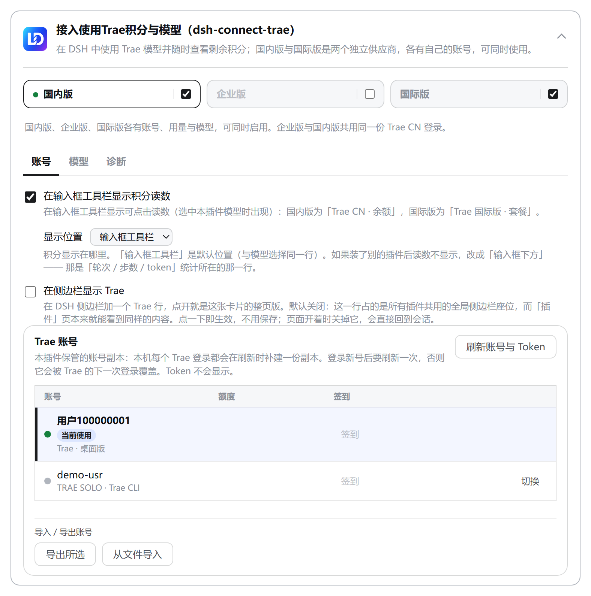
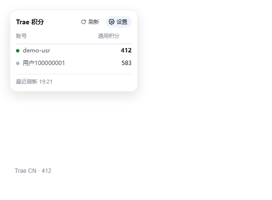
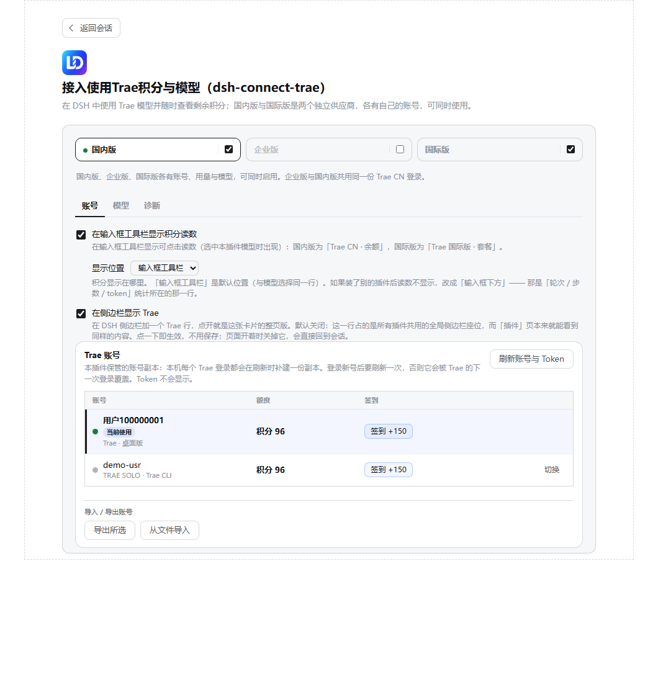

> 2026-11-09: configurable refresh intervals and single/keyed model-label compatibility. See [integration scope and checks](docs/UPSTREAM-INTEGRATION-2026-11-09.md).

CN accounts provide expandable credit-pack history: baseline, grants, spend, expiry and adjustments derived from account snapshots, never attributed to an individual request or conversation. See [credit history and cache compatibility](docs/CREDIT-HISTORY.md).

Local integration has been checked against upstream 4.15.0, including legacy settings navigation, aligned account rows, original-icon defaults and sticky save boundaries. Enterprise isolation and account-switch feedback remain enabled. See [integration notes](docs/UPSTREAM-INTEGRATION-2026-11-08.md).

> Local review: settings contain Accounts, Models, Capabilities and Diagnostics. Screenshots below show earlier versions. Historical host comparisons describe their named releases; current development dependencies are DSH 0.2.2-rc.1, pi-ai 1.3.0 and schemastery 3.19.0. The SemVer table uses includePrerelease: true. Account pools may automatically select and retry accounts only when explicitly enabled. Compatible JSON fields do not make WorkBuddy credentials valid for Trae. Later toolbar registrations move left automatically.

> Local maintenance: see [module split and checks](docs/MODULE-SPLIT-PLAN.md) and [local deployment](docs/LOCAL-DEPLOYMENT.md). This checkout uses the `kiwaro/dsh-connect-trae` fork and retains upstream copyright and version.

<p align="center">
  
</p>

> Account names, balances and timestamps in this document and its screenshots are **demo data** (`demo-*`); no real account information is shown.

<h1 align="center">dsh-connect-trae</h1>

<p align="center"><b>Connect locally signed-in Trae models to DeepSeek Harness with local DSH tools, a credits overview, and daily check-in claiming.</b></p>

<p align="center">
  <a href="README.md">中文</a> ·
  <a href="#install">Install</a> ·
  <a href="#how-it-works">How it works</a> ·
  <a href="#model-coverage">Model coverage</a> ·
  <a href="CHANGELOG.md">Changelog</a> ·
  <a href="https://github.com/dingminhua/dsh-connect-trae/issues">Issues</a>
</p>

<p align="center">
  <a href="https://www.npmjs.com/package/dsh-connect-trae"></a>
  <a href="https://www.npmjs.com/package/dsh-connect-trae"></a>
  <a href="https://github.com/dingminhua/dsh-connect-trae/actions/workflows/ci.yml"></a>
  <a href="LICENSE"></a>
  <a href="https://github.com/dingminhua/dsh-connect-trae/stargazers"></a>
  <a href="https://dshfind.com/plugins/dingminhua/dsh-connect-trae"></a>
</p>

A [DeepSeek Harness (DSH)](https://github.com/deepseek-ai/deepseek-harness) bundle plugin that connects locally signed-in Trae models (**CN, enterprise, and international installs**) to the DSH model picker. Trae generates structured tool calls while DSH executes its own local tools, with a usage overview (Work/general credits on CN, tenant allowance on enterprise, subscription status on international), daily check-in claiming, and a model-management panel. **The CN, enterprise, and international sides are three parallel providers (`trae` / `trae-enterprise` / `trae-global`) that can be used at the same time**; the settings page (**Settings → Trae**, its own page in the settings nav) separates them with tabs for convenient management.

**Runs on macOS, Windows, and Linux**: CI runs the full typecheck / test / build matrix on `ubuntu-latest` and `windows-latest`, and Windows gets purpose-built handling for directory probing, app version headers, and lock behavior — see [Windows notes](#windows-notes).

> Reading account status, balances and model catalogs does not spend model credits. Chats, pool probes and image generation may spend credits. Check-in claims and account switches write account state.

> Accounts, credentials, model catalogs and request routing remain isolated. Only toolbar order reservations are shared with WorkBuddy.

<a id="features"></a>

## 1. Features

Credentials now retain their account device identity, reused for requests and refresh. Missing bindings and shared devices are shown in account diagnostics. See [account device binding and 4017 troubleshooting](docs/ACCOUNT-DEVICE-BINDING.md). Exports may include device signing private keys and must be protected like passwords.

Manual account switching stops automatic selection for the current panel before saving the account. Pool membership, model settings and other panels are preserved. Enable and save the panel's pool again to resume automatic selection. In automatic mode, SOLO quota exhaustion (4008) and account risk restrictions (4017) trigger account failover within the request's attempt limit; requests still fail when no usable member remains.

Automatic failover adds an account switch notice before the response, with the previous account and failure reason. Final refusals and interrupted streams identify the account and reason in the turn error and pool activity. The credits popover shows per-account failure details and the latest five events. Both manual switch controls report success or the actual failure reason. Runtime history is cleared when the plugin restarts.

- **Three parallel providers** — the CN side registers as the `trae` provider (e.g. `DeepSeek-V4-Flash`, `DeepSeek-V4-Pro`), the enterprise side as `trae-enterprise`, and the international side as `trae-global` (the Gemini/GPT/MiniMax roster); **all three rosters appear in the DSH model picker simultaneously**: different sessions can each pick a side without interfering.
- **Enterprise is a separate billing channel, not an alias for CN** — the same CN credential, when it belongs to a `tob_online` tenant, is served by **two** gateways: the consumer pool (billed against personal credits) and the tenant pool (billed against the enterprise allowance). Same model, two payers, so **you** choose who pays; the plugin never guesses. `trae` never touches the enterprise gateway, and `trae-enterprise` **never falls back** — a refusal is reported as a refusal instead of quietly re-running on personal credits. Enterprise is **off by default**: a personal-only account cannot use the tenant pool, so shipping it enabled would mean handing everyone a provider that fails on first use.
- **Any panel can be switched off on its own** — each tab carries its own checkbox (CN and international checked by default, enterprise not): unchecking **withdraws that provider from the DSH model picker entirely** (not merely hiding the tab) and stops all of its requests; checking it again restores it with the account, directory, picks, and context budgets intact. If you never use the international side, just uncheck it.
- **Tabbed settings card** — the card's top carries a "Domestic / Enterprise / Global" tab bar; each tab holds its own account picker, usage overview, and model management. Account, directory, selection, and unsaved drafts are fully isolated per tab — switching accounts or refreshing models on one tab never touches the other side's runtime catalog or sessions. CN and enterprise share one CN credential pool but keep **separate account bindings and model picks**: the two rosters differ (`DeepSeek-V4.1-Flash` is listed only on the enterprise pool), so picks never overwrite each other.
- **Four settings sections** — Accounts manages sign-ins, balances, check-in and pools. Models manages model picks and context budgets. Capabilities controls the readout, sidebar entry and image generation. Diagnostics displays provider, token expiry and recent errors. Switching sections preserves model drafts; the model list has no inner scrollbar.
- **Multiplier in the model name** — model names show the credit multiplier in Trae's own menu format (e.g. `GLM-5.2 · x0.79`), updated with each directory refresh.
- **Promotion badge** — Trae publishes its discount rules in the model directory (`activity_discount`: pay ratio, list price, off-peak windows with their time zone). The plugin judges them against **the clock at render time** and paints one capsule beside the model name (`5 折` / `off-peak 5 折` / `limited 5 折`), with the old price, the new price and the window on hover. Local windows are recalculated at render time; an upstream current snapshot can be stale, and off_peak windows are checked when current reports no discount, the multiplier is never used to guess a promotion, and no campaign without an end time is labelled "limited". It is information only: no request and no billing changes, and the international region (subscription) has no such data and therefore shows no badge. See [docs/PROMO_BADGE.md](https://github.com/dingminhua/dsh-connect-trae/blob/main/docs/PROMO_BADGE.md).
- **DSH local tool loop** — gets pending structured `tool_calls` from Trae `llm_utils_chat`, lets DSH execute its own local tools, then returns tool results to the model.
- **Text-to-image (`trae_draw_image`)** — brings the signed-in account's Trae text-to-image service into the conversation: the model draws one image and the plugin **fetches the bytes too**, writes them under the session cwd and shows the picture inline. **Off by default, enabled per panel** — generation really spends credits (measured: ~8.8 for one `1920x1920` on CN personal), so unlike the image-input declaration it only happens when you say so. Protocol, size bounds, the two-step fetch and why the old "fetch" GET is really a second generation are in "Text-to-image" below.
- **Dual-region detection (CN / international)** — detects local sign-ins across Trae CN, TRAE SOLO CN, Trae, and TRAE SOLO installs. The region is derived from the credential's own `userRegion` claim (host suffix and edition label as fallbacks), with no manual switch. **The US cluster (`userRegion: "US"` / `*.traeapi.us`) is recognized but not served yet**: a US credential is never routed to the Singapore gateways; the account panel names the account and says the region is unsupported, and that signing in again changes nothing (issue #66).
- **Region-isolated directories and selections** — CN and international each keep their own model directory, enabled picks, image opt-ins, and context budgets, and each provider reads only its own slot.
- **Vision follows Trae's own declaration** — when Trae marks a model `multimodal`, the plugin advertises it as such with no manual tick per model (issue #16). The rule is "**models you tick ∪ models Trae marks multimodal**": models Trae marks `false`, or does not mark at all, stay text-only and can still be turned on by hand. A row enabled automatically is shown ticked and read-only, with the reason. See "Image input" below.
- **Account switching** — refreshes the token list and lets users select an account without storing tokens in DSH settings. **Your choice is remembered and stays in effect**: with the account pool disabled, the plugin will not switch accounts automatically just because the bound one ran out of credit or another usable one was found (switching bills a different person). So when the bound account is exhausted the card **says so explicitly** and lists the other accounts on this machine that still have credit, with their balances, for you to switch to in one click — instead of showing an empty panel or quietly rebinding you. "Refresh accounts & tokens" now always reports what happened (how many accounts were found, who is still bound) instead of appearing to do nothing. The dropdown names the product (`Trae` / `TRAE SOLO` / international) so a credential left behind by an uninstalled app is recognisable.
- **Read-only usage and model management** — Work/general credits on CN accounts, subscription/trial status on international ones; enable Trae models freely. Read-only queries consume nothing.
- **Per-model thinking level, and the default is no longer just `Default`** — Trae's directory has always published each model's own default level, and the plugin has always parsed it into the catalog, but **it was never reported to DSH**. The model picker could therefore only say `Default`: you could not see which level a model would run at, and you could not pin a different one. The adapter now reports that level, the host materialises it into every request that names none, and each model that declares levels gets a dropdown whose first entry names **the level it will actually run at** (e.g. "Default (high)"). Precedence is **your choice > upstream default > that model's own middle tier**; choosing "Default" DELETES the key rather than storing a level that happens to equal today's default — the latter looks identical while quietly pinning the choice, so the model would stop following upstream. A saved level the directory has since withdrawn is ignored rather than sent, because sending it is rejected with `UNSUPPORTED_REASONING_EFFORT`. Choosing nothing behaves exactly as before.
- **Credit-near-expiry notices** — the remaining balance only says "how much is left", not "**which pack lapses first**". The notice escalates by urgency (7 days → 3 days → 24 hours → already lapsed) and names the amount, the pack count and the soonest expiry, so a user watching only the total never silently loses the pack that expires first. Shown in both the usage card and the composer credits panel on the CN side (the international side is subscription-based and has no per-pack expiry).
- **One-click test of the enabled models** — sends each **enabled** model one minimal message (a single `ping`, no tools) and reports whether it actually answers: **works** / **needs a higher plan** (Trae `1005`; your plan does not cover it) / **not served** (`4001`; no SOLO function serves it) / **throttled** (`4011`; Trae rate-limited that route) / **sign-in rejected** / **not determined**. The last one is a first-class outcome: a timeout, a dropped connection, a proxy or a 5xx is **never** reported as unusable — only an explicit upstream refusal is a negative verdict. Model and pool probes spend quota when requested; chats and image generation may also spend credits. Probe results remain in the current session rather than your settings.
  > `4011` is a **rate limit**, not "this model is unavailable" (measured for issue #33): an exhausted balance reports a different code, `4008`, so "I still have plenty of credits" and "I got a 4011" are both true at once. Keep the model and retry later. The upstream response determines any recovery time.
- **One-click test of all models** — the same probe applied to **every visible model** of the current region, not just the enabled ones. Use it when you want to know whether the models you have switched off could still answer — after a plan change, or after Trae reshuffles its lineup.
- **Daily check-in claiming (per account)** — on the CN card **every account row carries its own check-in button**, with the day's reward written on it (`Check in +150`). A row reads **Claimed** and disables itself once *that account* has been paid, and reads **Device used** and disables itself when *the same device* has already spent today's slot through some other account — the two are reported honestly, and the second is never dressed up as "claimed". A row click claims for that account. The pool also provides a batch claim; an upstream 9095 response skips subsequent accounts sharing that device and marks them as Device used, while other bound devices continue (legacy unbound accounts form one compatibility group). Trae allows one check-in per device per day; switching accounts on the same device does not reset this allowance. The international side has no check-in activity, so no button is shown there.
- **Composer readout and account switching** — Enable it under Capabilities. CN uses `Trae - CN`, with a credits column backed by the general balance; international accounts show their plan. The readout appears only for the selected Trae channel and region; it is hidden when WorkBuddy or another provider is selected. The panel has account, balance/plan and action columns. Current accounts show In use, other accounts show Switch, and pending writes show Switching. Refresh probes the checked pool members and may spend credits; Settings opens this plugin page.

  

  Choose the composer toolbar or the statistics row below the input in Capabilities. The choice is saved per panel. Trae and WorkBuddy reserve toolbar order in memory; a later registration moves left and releases its reservation when disposed.

- **Optional: put Trae in the sidebar** (learned from the sibling `dsh-connect-workbuddy` PR #188, and **off by default** here too). Ticking "Show Trae in the sidebar" in the card's Capabilities section adds a Trae row to the DSH sidebar; it opens the **full-page version of this same card** — same region tabs, same account / models / capabilities / diagnostics sections, minus the card frame, with a title, a description and "Back to conversation" at the top. **Why it is off by default**: the sidebar's global rows are the host's own pages, and this row claims a seat **every installed bundle shares** while the settings page already reaches the same content — a nav row nobody asked for re-arranges a surface this plugin does not own. **It takes effect on the click** with no Save: writing `sidebarPanel` registers or disposes the row in the same second (it is not a component rendering null — that would leave a blank but still clickable button), and switching it off while the page is open sends the centre column back to the conversation by itself. The page's back control goes through the host's `layout.selectPanel(null)`; on a host without that service the control is **omitted rather than drawn dead**.
  


- **Secure loopback shim** — one random port + in-process random secret per region; the real Trae token is never handed to pi-ai.

Under More settings → Icon style, choose Claude style line icons or the default icon. Claude style is the default. Changes take effect immediately and are saved separately for each plugin in the current browser.

### Daily automatic check-in

The domestic personal account pool offers automatic check-in, disabled by default. Enable and save to check in selected members while DSH runs. Progress survives restarts and failed attempts retry with backoff. This setting is independent of automatic billing selection. Trae limits daily rewards per device, so not every member can receive a reward. Global and enterprise panels do not offer automatic check-in.

<a id="how-it-works"></a>
## 2. How it works

```text
DSH PiAiAdapter (one stack per provider)
  -> secure loopback shim (one random port + in-process random secret per region)
  -> TraeSoloBridge
  -> CN: https://trae-api-cn.mchost.guru/api/agent/v3/llm_utils_chat
  -> Enterprise: https://console.enterprise.trae.cn/api/agent/v3/llm_utils_chat
  -> Global: https://coresg-normal.trae.ai/api/agent/v3/llm_utils_chat
  -> Trae SSE / pending function_call
  -> OpenAI SSE tool_calls
  -> DSH executes local tools and returns their results
```

Each panel owns a complete runtime stack — credential store, model catalog, wire map, upstream clients, loopback shim, adapter — with visibility filtered by the credential's own region claim, so **accounts from several regions can be signed in and used by different sessions at the same time**.

**A panel is not a region.** `cn` and `ai` happen to line up with the two regions, but the enterprise pool shares the `cn` credentials while billing a different account and serving a different roster — it needs its own switch, its own account binding, and its own model picks. That is exactly what a "panel" is. Keeping panel and region as two concepts lets `enterprise` ride the same settings pipeline with no change to the stored shape: it is just another slot in the `regions` map.

The CN region therefore publishes two providers side by side, and **the route is fixed when the provider's client is built** — there is no "guess once per call". The shim exposes one bearer route per provider and dispatches by bearer; an unknown token gets a 401 rather than falling back to the first route. The enterprise gateway requires a `session_id` on every call while the consumer gateway rejects a body carrying one, so it is added only on that route.

Usage overview hits the read-only `https://api.trae.cn/trae/api/v2/pay/*` and `/trae/api/v2/ug/*` endpoints (international accounts read their own gateway's subscription status); the daily check-in claim is the one write among them, going to `POST /trae/api/v2/ug/checkin_credits/claim` with the account's saved device identity (`x-device-id`, the same identity the chat path sends), falling back to the installation identity for legacy unbound accounts. That device id is also what Trae keys the "one check-in per device per day" rule on, so switching accounts on the same device does not reset the day's slot. Refreshed tokens are kept per region in `$DSH_HOME/.trae-auth.cn.json` and `$DSH_HOME/.trae-auth.ai.json` (two simultaneously signed-in accounts never overwrite each other; the legacy single file `.trae-auth.json` is still read as a migration source).

> See `docs/IMPLEMENTATION_PLAN.md`, `docs/SOLO_ROUTE_DECISION.md`, `docs/USAGE_API_RESEARCH.md`.

<a id="relationship-to-other-plugins"></a>
## 3. Relationship to other plugins

**Accounts, billing and model requests are managed independently by this plugin.**

- **Independent business state.** Accounts, credentials, the model directory, the account pool, access tokens and the device id belong to this plugin alone; it reads and writes only its own files (`$DSH_HOME/.trae-auth.*.json`, `.trae-auth.deleted.*.json`, `.trae-pool.*.json`) and its own settings namespace — it does not read other plugins’ credentials or billing data; toolbar order uses a shared temporary reservation. It does edit the Trae desktop app's own sign-in file, but that is another **application**, not another plugin.
- **No cross-plugin account or credit scheduling.** The pool ranks and switches only among this plugin's own accounts; a `trae` failure is a failure — it never borrows another connector plugin's account, credit or channel, and never hands a request to another plugin to retry. The reverse holds too: this plugin exposes no cross-plugin proxy API.
- **Toolbar order coordination.** Trae and WorkBuddy share an in-memory order reservation in the renderer. The later registration moves left and releases its reservation on disposal or failure. Credentials, accounts, settings and request routing remain isolated.
- **No shared switches.** Turning one panel off withdraws only this plugin's provider and requests; it never changes another plugin's provider, models, binding or settings.

**Why the boundary exists.** Once plugins depend on each other, any upgrade, uninstall or version-line change silently alters the behaviour of its neighbours — and DSH's load order, parallel versions and user-authored profiles make that coupling impossible to express reliably. Holding the boundary keeps "who is broken" answerable with **one** plugin instead of a chain.

> Sibling plugins **learn from** each other (lessons from `dsh-connect-workbuddy` are quoted in this repository's comments and tests) but never **call** each other — learning is a compile-time affair, interoperation is a runtime one, and the two must stay apart.

<a id="image-input"></a>
## 4. Image input

The plugin declares whether a model accepts images, and DSH uses that to decide whether an attachment is **sent as-is** or **degraded into a text description**. That makes the declaration a hard switch, not a cosmetic label.

The rule is the **union of two sources** (issue #16):

| Source | Meaning |
|---|---|
| Trae's own `multimodal` field | Trae's own answer to "does this model read images". The Trae IDE's attach-image button is driven purely by this field, with no user switch |
| Your manual `imageModelIds` ticks | Explicit choice. Even if Trae later stops reporting the flag for that model, your tick is never revoked |

Notes:

- **Only `multimodal === true` enables it automatically.** A missing field or an explicit `false` does not enable image input automatically. Manual selection can still enable it.
- **Automatic does not mean automatic sending.** It only lets DSH attach an image to that model; you still choose to attach one per message. The plugin never sends an image on your behalf.
- **An automatically enabled row is shown ticked and read-only.** Under the union, unticking it would be re-applied immediately, so that row does not offer an untick action. There is currently no per-model "force off" escape hatch; if you want one, say so on issue #16.
- Manual ticks still work for models Trae marks `false` (or does not mark), which is the escape hatch for "upstream does not say so, but it actually works".

<a id="text-to-image-trae_draw_image"></a>
## 5. Text-to-image (`trae_draw_image`)

The text-to-image service behind TraeWork / SOLO is now reachable from a DSH conversation: the model **draws one image** and the result is written to a local file.

**Off by default, switched on per panel.** Generation **really spends credits** (measured: ~8.8 for one `1920x1920` on CN personal), so this is not the image-input kind of declaration — it is an explicit spend gate. Tick "Allow the model to generate images" (`drawImageEnabled`) in the card's Capabilities section and that panel's `trae_draw_image` gets registered with DSH; unticking removes it immediately. Each panel stores its own switch; the enterprise and international panels do not offer one — the former's tenant gateway is a separate billing surface, the latter bills under another plan, and neither has been measured, so the plugin does not pretend otherwise.

The following protocol details were recorded in the original experiment; current availability and charges depend on upstream responses:

| Item | Fact |
|---|---|
| Endpoint | `POST /api/ide/v1/tool_text_to_image` (plus an SSE variant `..._stream`), model `seedream_5` |
| Request body | Only `{prompt, image_size?}`. Adding known fields (`mode_type` / `session_id` / `image_urls` / `watermark`) earns a 400 with an empty body; unknown fields are ignored |
| Success | Flat `{"message":"success","uri":"tos-cn-i-…/cn/<uid>/gen_image/<ts>_<hex>_jpeg_1920x1920"}` — **no** `{code,msg,data}` envelope |
| Sizes | Total pixels must land in **3686400 ~ 16777216**: `1024x1024` is rejected as too small (`code 3003`; no image was generated and no billing receipt was returned) and `4608x4608` as too large; presets `2k`/`3k`/`4k` work, default is `1920x1920` |
| Fetch | **Two steps, no extra charge**: `POST /api/ide/v1/get_resource_url` whose body must be exactly `{"uri_list":["<key>"]}` (`{uri}`/`{path}`/`{resource_uri}`/`{uris:[…]}` and GET `?uri=` all answer 200 with an empty `url_map`), replying `{"url_map":{"<key>":"<byteimg signed URL>"}}`; then a plain GET of that signed URL (**no Trae headers** — the signature is in the query) returns the bytes: measured `image/jpeg`, 1,155,578 bytes, header `ffd8ffe0` |
| What that GET really is | Decisive probe: after the POST returned `…/1792954795741_44f94116_jpeg_1920x1920`, the GET with the same `(prompt, size)` came back with a **different** uri (`…/1792954810505_b107ac11_jpeg_1920x1920`) after 27 s and zero pixels — a second image and a second charge (~17.6 for the pair). The illegal-size probe agreed: the error is Ark's own `[callArkImageGeneration]` |

**The tool returns a local image file.** On success the tool returns `url` (the Trae object key, kept for diagnostics), `path` (a local file relative to the session cwd, e.g. `trae-images/trae-20261026-042015-ab12cd.jpg`), `model`, `prompt`, `size` and a `hint`; the renderer emits `` — DSH's chat resolves that relative path against the session cwd and reads the bytes through the host's authenticated `api/file` route, so the picture shows up inline. Only when the bytes genuinely could not be fetched (`IMAGE_UNAVAILABLE`: the image was generated and the generation request may have been charged) does it fall back to inline-code "key only", and such a failure still starts the 30-second cooldown — generation is billed per image, so generating again may incur another charge.

**Image editing and text-to-video are not opened up.** Editing needs a TOS upload presign first (this plugin has no such path); video polls a material result — a separate async pipeline. Neither ships, and neither leaves half an entry point behind.

<a id="model-coverage"></a>
## 6. Model coverage

This plugin serves models from Trae's **SOLO channel** (`DeepSeek-V4-Flash-Official`, `DeepSeek-V4-Pro-Official`, `GLM-5.3`, `GLM-5.2`, `Kimi-K3`, `MiniMax-M3`, `Qwen3.8-Max`, `Doubao-Seed-*`, …), for both the domestic and international sides.

The following two models currently come from the **TraeCode (Trae IDE) channel** and have **not** been opened up to the SOLO channel:

| Model |
| --- |
| `kimi-k2.8-preview` |
| `qwen3.8-flash` |

They **do appear in the model list** (Trae's directory advertises them), but the plugin has no channel that can call them yet. Sending a message with one selected produces an **explicit error**, for example:

```
Trae does not serve this model under the SOLO function the request used
(config_name rejected) · Trae code 4001 · upstream: We're sorry, the param is invalid…
```

That is the upstream refusal stated plainly, rather than a silent failure or something that reads like a network fault. **Once Trae opens them up to the SOLO channel the plugin picks them up automatically** (the test is simply whether a callable id can be resolved) — no plugin upgrade needed.

> **Why they are listed now (policy from 2026-10-02)**: such rows — present in the directory but with no resolvable callable id — used to be **hidden outright**, on the grounds that showing one only produces an error. But the callable rosters are issued **per account tier**: not seeing a model on a free account does not prove a paying account cannot call it (the reporter in issue #19 is on Pro, and their account calls models this machine's free account gets gated on). **Hiding models the user's own Trae IDE lists is worse than showing an explicit error**, so the behaviour is now: list everything, report refusals honestly.

> `deepseek-v4.1-flash` used to be listed here — `docs/DS41_CALLABILITY.md` (evidence gathered 2026-09-15) measured `4001 param is invalid` from all eight SOLO functions. **Trae has since opened it up to the SOLO channel**: it now ships in the live directory with `wireFunction: solo_work_remote` and calls succeed (verified against a live refresh). This page had not caught up, so it is removed from the table.

> `glm-5.3-flash` used to be listed here too, and is **removed as of 4.4.0**: Trae has since opened it up, and it now ships in the live wire roster with `wireFunction: solo_work_remote` (verified). The directory side always advertised it — it was listed because the Remote directory named it while the wire roster did not, so it had no callable id and never entered the callable roster. 4.4.0 fixed both "the wire has it but the directory does not" and "the directory was asked for too few groups", and it now appears as an ordinary callable model.

> Note the distinction: **`GLM-5.3` is supported** (it goes through the SOLO channel). **`glm-5.3-flash` is now supported too** — it was always a different model from `GLM-5.3`, but it has since been opened to the SOLO channel.

To use these two models today, use the **Trae IDE itself**.

<a id="max-output-and-context-budgets"></a>
## 7. Max output and context budgets

The "最大输出" (max output) on the model card comes from `model_detail_list[].max_tokens` in Trae's `get_detail_param` — upstream **does** publish it (live-verified: 80/80 CN configs carry it). As of 4.0.1 the value travels through the catalog merge all the way to the card, `/models/refresh` and DSH model registration; before that the merge step dropped the field, so the whole region rendered blank (issue #42 — full diagnosis in `docs/ISSUE42_DIAGNOSIS.md`). **Rows that are still blank are being honest**: models the directory lists but the SOLO roster has no config for (the two TraeCode rows above) have no candidate value to show — we prefer a blank over an invented cap. The value is metadata only; the plugin never puts `max_tokens` into request bodies (the server decides the real cap).

Context windows are a per-model choice between Trae's default (dev) window and its Max window — **and, as of 4.4.8, a 500K middle step for wide-window models** — stored per panel as `contextBudgets`. 500K is **not** an upstream-advertised window; it is a local half-way point. Dev windows are typically 200K/256K/272K and Max is typically 1M, so going straight from default to Max is a 5× jump, and Max-tier billing is not what every session needs. It is therefore **conditional**: the option only appears when that model's Max is at least 500K, and 500K is genuinely wider than its dev window and narrower than its Max. `applyContextBudgets` validates against the **same rule** (`contextBudgetOptions`), so a stored value that is not one of that model's selectable windows always falls back to the dev window — it can never push a model past a window it does not have (if upstream later shrinks a model's Max to 256K, a stale 500K quietly stops applying instead of overflowing).

For a whole-region switch, the model section has three buttons: "**Switch all to 500K**" (writes 500K for every row whose Max is at least 500K, leaves the rest alone), "**Switch all to Max**" (writes each Max-capable row's `maxContextWindow`, leaves no-Max rows and existing manual budgets alone) and "**Restore default context**" (clears the region's budget dict). All act on the draft and take effect on Save, producing exactly the same stored shape as the per-row radios (issue #42 side request — 18 Max rows in CN used to mean 18 clicks).

<a id="install"></a>
## 8. Install

```sh
dsh plugin --profile desktop add dsh-connect-trae
```

Or directly via npm:

```sh
# 在目标 DSH profile 目录中执行 / Run inside the target DSH profile directory
npm install dsh-connect-trae
```

Restart the DSH process after install/update/uninstall.

<a id="dsh-version-compatibility"></a>
## 9. DSH version compatibility

**Requires DSH 0.1.7-rc.1 and up** (since 2.3.0 the plugin no longer targets hosts older than 0.1.7; the peer dependency ranges are narrowed accordingly).
**The peer upper bound is `<0.3.0-0`, so both the 0.1.7 and the 0.2 line are supported (including 0.2.2-rc.1, verified).**

<a id="both-pi-ai-context-generations-are-supported-since-342"></a>
### 9.1. Both pi-ai context generations are supported (since 3.4.2)

DSH itself spans two generations of `@earendil-works/pi-ai`, and **which one this plugin resolves to is decided by your install**, not by the host — declaring it a peer is correct, but the two generations disagree on what a context looks like:

| | legacy (≤0.85) | modern (0.86+) |
| --- | --- | --- |
| shape | `{ systemPrompt, tools, messages }` | `{ messages: [ {role:'system', content, toolsAdded}, … ] }` |
| system prompt | top-level `systemPrompt` | **only** on that system message |
| tool declarations | top-level `tools` | **only** on that system message's `toolsAdded` |

A mismatch breaks **in both directions**, so since 3.4.2 the plugin adapts bidirectionally according to the generation it resolved (issue #27):

- **Modern host + legacy library**: a guaranteed crash — the legacy token estimator has no `role === 'system'` branch, so it iterates a string and throws `Cannot read properties of undefined (reading 'length')`. This happens before the request is built, which is why it looks like "every model crashes, within milliseconds, with all-zero usage".
- **Legacy host + modern library**: no crash, but the modern api reads only that system message and silently ignores the top-level fields — the system prompt and **every tool declaration** are lost, so the model can never emit a tool call. Quieter, and also fixed.

The generation gate is the copy **this plugin resolved** (its manifest version; package layout when that is unreadable), **not the host version** — a nested older copy shadows a newer host copy and vice versa. Startup logs one line, `dsh-connect-trae: pi-ai <version> (<generation>)`; `legacy` means your install resolved to the ≤0.85 line.

The boundary is **0.86**: `dist/utils/transcript.js`, `normalizeContext`, the estimator's system branch, and the switch away from the top-level fields all land in 0.86.0 together. Gating on `0.87` misclassifies 0.86.x as legacy and folds a context the modern api consumes natively, destroying the prompt and the tools.

The 0.2.0 line breaks **no** contract this plugin consumes — a symbol-by-symbol check confirmed every API it imports is unchanged ([full 0.2.0-rc.1 impact check](https://github.com/dingminhua/dsh-connect-trae/blob/main/docs/DSH_0.2.0_RC1_IMPACT_CHECK.md)). But since 0.1.7 DSH enforces a **bundle-level peer gate**: a bundle whose peers are unsatisfied is skipped **whole**, with one line on stderr and nothing in the UI — the plugin simply disappears.

<a id="dsh-021-line-pi-ai-110-sync"></a>
### 9.2. DSH 0.2.1 line (pi-ai 1.1.0) sync

The `0.2.1-rc.1` host moved `@earendil-works/pi-ai` from `^0.85.1` to **`^1.1.0`** (unchanged from `0.2.1-rc.2` through `0.2.1-rc.5`) — the only change on the 0.2 line with real behavioural impact. Three conclusions:

1. **The request body did not regress (measured, not inferred).** The 1.1.0 api reads the prompt **only** from a transcript system message and never touches top-level `systemPrompt` / `tools`, while `dsh-llm-pi-ai`'s `piContext()` still emits the legacy envelope. The bidirectional adapter this plugin has shipped since 3.4.2 covers exactly that: feeding the real host envelope through real `1.1.0` with a local SSE capture yields `roles: ["system","user"]`, an intact system text and `tools: 1`; **without the adapter it degenerates to `roles: ["user"]`, system `null`, `tools: 0`** — with no error. That contrast is pinned as a wire-level matrix in `tests/pi-ai-context.spec.ts`.
2. **Types were fixed.** 1.1.0 changed `ProviderStreams`' second parameter to a **branded** `TranscriptContext` (a `unique symbol` only `normalizeContext()` can produce). The adapter casts once at that single boundary (`withContextAdaptation` in `src/adapter.ts`) and documents why the brand cannot be obtained honestly there.
3. **The peer range needed no change.** DSH evaluates with `semver.satisfies(runtime, range, { includePrerelease: true })` and checks only the `@deepseek-ai/dsh*` namespace, so `>=0.1.7-rc.1 <0.3.0-0` already admits every release from `0.2.1-rc.1` through `0.2.1-rc.5` (verified). Note the prerelease cliff only exists under **default** options — it is not this plugin's situation.

That release pinned `@earendil-works/pi-ai` at exactly **1.1.0** (the version the host actually bundles — still 1.1.0 on `0.2.1-rc.5`) rather than `^1.1.0`, so local typecheck and tests run against the same contract users do; the `schemastery` override moved to `3.18.5` (`dsh-llm-pi-ai@0.2.1-rc.5` declares `~3.18.5`).

<a id="021-rc3-sync-since-446"></a>
### 9.3. `0.2.1-rc.3` sync (since 4.4.6)

The host moved to `0.2.1-rc.3` (the desktop app's `CFBundleVersion` and the bundled `dsh-desktop-runtime` both report `0.2.1-rc.3`). Upstream shipped five commits: three of them are the new "navigation entry customization" UI (pin/unpin plugin launchers, a More menu, analytics), one switches the DeepSeek API-key route to the official `/models` listing, one is the version bump.

For **this plugin**:

- Of the 13 host packages the plugin consumes, **only `dsh-client-ui-primitives` changed code**, and every change is **additive**: `Tooltip`'s `TooltipSide` gains `'left'` and now places the bubble from measured border boxes (preferred → opposite → perpendicular side), `MenuItemButton` gains `current`, `Menu` gains `minWidthFromAnchor`, and the icon set gains `IconAppsAddOutline*`. This plugin references `dsh-client-ui-primitives` **at the type level only** (`import type {} from ...`) and never touches those components at runtime, so **no adaptation is needed**.
- The other 12 packages (`dsh-llm`, `dsh-llm-pi-ai`, `dsh-settings`, `dsh-host-webserver`, `dsh-atomic-write`, `dsh-home-paths`, `dsh-attachment`, `dsh-client-ui-renderer`, `dsh-client-ui-settings`, `dsh-client-ui-settings-plugins`, `dsh-client-ui-slots`, `dsh-client-locale`) are **byte-for-byte unchanged**.
- The registered slots `plugins.bundle.config`, `plugins.row.config`, `conversation.input.right`, `conversation.composer.dock`, and `conversation.input.model.label` remain available on rc.3. The host's new slots, such as `conversation.session.header.views.actions`, are separate registration points.
- The peer range **needs no change**: `0.2.1-rc.3` is admitted by `>=0.1.7-rc.1 <0.3.0-0` (verified).

Details: [section 10 of `docs/DSH_0.2.1_RC1_SYNC.md`](https://github.com/dingminhua/dsh-connect-trae/blob/main/docs/DSH_0.2.1_RC1_SYNC.md).

<a id="021-rc5-sync-since-466"></a>
### 9.4. `0.2.1-rc.5` sync (since 4.6.6)

The host moved to `0.2.1-rc.5`, through `rc.4`. Of the 13 commits between the two releases, roughly 240 files are nothing but version-bump lines in each package's `package.json`; **only four carry real code**: ACP/MCP moving catalog-load diagnostics off stdout to stderr, View tab tooltips shown only when the label overflows, the More-menu tooltip losing its dynamic copy, and custom thinking-block rendering.

For **this plugin**:

- The 13 host packages it consumes are **byte-for-byte identical** between rc.3 and rc.5 — including `dsh-client-ui-primitives`, the one package that had changed on rc.3. **Zero adaptation.**
- rc.4's only behavioural change is to the `conversation.chat.reasoning.body` slot: it gains `rawText`, and `text` becomes the **display-ready** text (with a leading `<signature>…</signature>` block stripped). This plugin registers and consumes **no** `conversation.chat.*` slot at all, so it is not affected.
- rc.4's reason for moving diagnostics off stdout is that "ACP reserves stdout for protocol messages". This plugin's host half **never writes to stdout** (no `console.log/info/debug`, no `process.stdout.write`); diagnostics go to the card's own diagnostics panel. That fix is therefore **a precondition already satisfied**, not a pattern to follow.
- All five slots this plugin registers **still exist with unchanged contracts** on rc.5.
- The peer range **needs no change**: both `0.2.1-rc.4` and `0.2.1-rc.5` are admitted by `>=0.1.7-rc.1 <0.3.0-0`.

Details: [section 11 of `docs/DSH_0.2.1_RC1_SYNC.md`](https://github.com/dingminhua/dsh-connect-trae/blob/main/docs/DSH_0.2.1_RC1_SYNC.md).

<a id="022-rc1-sync-since-481"></a>
### 9.5. `0.2.2-rc.1` sync (since 4.8.1)

The host moved to `0.2.2-rc.1`. This release is **not just version bumps**: the bundled dependencies move as a set (`cordis` 4.0.5 → **4.1.0**, `schemastery` 3.18.5 → **3.19.0**, `@earendil-works/pi-ai` 1.1.0 → **1.3.0**), and **8 of the 13 host packages** this plugin consumes carry real changes.

For **this plugin**:

- **One contract break**: `dsh-llm-pi-ai` added two **required** fields to `ResolvedPiAiProviderProfile` — `maxRequestImages` and `imageOffloadCountQuantum`. This plugin builds that profile **by hand** from the live catalog (it bypasses the host's config resolution), so `pnpm typecheck` fails with `TS2739` after the bump. Both are now declared in `REQUEST_IMAGE_BUDGETS` with the host's own defaults, `50 / 10`.
- **Runtime was never broken**: the host only defaults those fields on its config-resolution path; a hand-built profile that omits them takes the "image count unchecked" branch on 0.2.2. That is why 4.8.0 keeps working there (verified on the desktop host: `GET /plugins/dsh-connect-trae/usage` → 200, `signed-in`).
- **New capabilities adopted where they matter**: the plugin now emits `llm/models-updated(provider)` when a region's catalog changes (deduplicated by a signature, so a settings write that rebuilds identical rows does not wake every consumer). And because `conversation.input.model.label` is a `single` slot, holding it suppresses the host's built-in "name + `model.badge`" label for **every** provider — so the component now renders another provider's `model.badge` (with language fallback) instead of dropping it. Its own rows are unchanged.
- **Deliberately not adopted**: the six new UI languages (this plugin keeps zh/en and falls back to English), `llm-pi-ai/request-headers` (no custom inference headers), `supportsMidConvoEffort` (not on the openai-completions route).
- **The three core values are unaffected**: dual-region providers, usage/credits overview, daily check-in. Their tests are green; this change only touches the image budget, catalog announcements, and the model label.
- The other six changed packages (`dsh-host-webserver` resource routes, `dsh-attachment` admission variants, the new languages in `dsh-client-locale` / `dsh-client-ui-settings-plugins`, the `dsh-client-ui-settings` icon slot, `dsh-client-ui-primitives` additions) are **additive**; this plugin either does not use them or already has an equivalent. The five unchanged packages (`dsh-atomic-write`, `dsh-client-ui-renderer`, `dsh-client-ui-slots`, `dsh-home-paths`, `dsh-settings`) are **byte-for-byte identical**, so every slot contract this plugin registers is unchanged.
- The peer range **needs no change**: `0.2.2-rc.1` is admitted by `>=0.1.7-rc.1 <0.3.0-0`, and `MUST_ADMIT` in `tests/dsh-peer-range.spec.ts` now includes it.

Details: [`docs/DSH_0.2.2_RC1_SYNC.md`](https://github.com/dingminhua/dsh-connect-trae/blob/main/docs/DSH_0.2.2_RC1_SYNC.md).


<a id="why-the-upper-bound-is-not-020"></a>
### 9.6. Why the upper bound is not `<0.2.0`

2.3.1 wrote `<0.2.0-0`, meaning "not the 0.2.0 release yet". That spelling is **wrong**: in SemVer `0.2.0-rc.1 > 0.2.0-0`, so it excluded the entire 0.2.0 **prerelease** line, and the plugin went dead the moment a user installed the first 0.2.0 prerelease.

| Spelling | 0.1.7 line | 0.2.0 alpha/rc | 0.2.0 release | 0.3.0 |
| --- | --- | --- | --- | --- |
| `>=0.1.7-rc.1 <0.2.0-0` ❌ | ✅ | ❌ | ❌ | ❌ |
| `>=0.1.7-rc.1 <0.2.0` | ✅ | ✅ | ❌ | ❌ |
| `>=0.1.7-rc.1 <0.3.0-0` ✅ | ✅ | ✅ | ✅ | ❌ |

`tests/dsh-peer-range.spec.ts` pins this invariant: every peer range must admit the 0.1.7 and 0.2 lines, must reject the 0.3 line, and `<0.2.0-0` may not come back.

> **Why this needs a dedicated test**: a wrong range passes `tsc`, every unit test, `pnpm install`, and CI — only a real host refuses to load it. That is exactly how 2.3.1 shipped green.

0.1.7 rebuilt the settings machinery, and the plugin follows the 0.1.7 contract:

- **Host registration**: `SettingsForms.configure({auto}, owner)` (`installSection` was removed in 0.1.7), and the namespace is the **Loader entry id the host actually serves** (`ctx.fiber.entry?.options.id`, falling back to `trae`) — the harness looks a provider's namespace up by exact match, so hard-coding `trae` made the provider read as "not configured".
- **Client settings surface**: `configForms` (`settingsScope` was removed in 0.1.7). `inject` declares only `slots` / `locale`; the settings surface is probed with `ctx.get()`. Cordis' dependency gate is hard — any `inject` entry the running line does not provide keeps `apply()` from ever running (this is why 2.2.0 and earlier sat at `pending (waiting for service: settingsScope)` on 0.1.7).
- **Config card slots**: `plugins.bundle.config` / `plugins.row.config` (`settings.plugin.item` was removed).
- **Schema writable marker**: writable fields must be marked `volatile()` (`asVolatile`), or 0.1.7's write gate rejects every write; 0.1.7 delivers config values as `{get(): T}` live references, so every read and merge path unwraps them first (`unwrapVolatile` / `unwrapVolatileDeep`).
- **The collapse caret is pure CSS**, with no static primitives icon import — icon naming changes across releases, so a static import is not a stable contract.

<a id="platform-support"></a>
## 10. Platform support

| Platform | Status | Notes |
| --- | --- | --- |
| **macOS** | ✅ Fully supported | Development and verification environment; directory names confirmed on a real host |
| **Windows** | ✅ Supported | CI runs `windows-latest`; account directory, app version headers, and lock behavior all handled. **Verified on a real host** (Windows 10.0.22621 + TRAE SOLO CN) — see below |
| **Linux** | ✅ Supported | Includes the WSL2 + Trae CLI case (issue #5); directory names probed as multiple candidates |

All three platforms share one implementation: account discovery, decryption, region routing, check-in, and usage queries are platform-independent. Platform differences are confined to **path resolution** (`src/paths.ts`) and the **device fingerprint** (`src/identity.ts`).

<a id="windows-notes"></a>
## 11. Windows notes

- **Account data directory**: the plugin reads `%APPDATA%\<directory name>\User\globalStorage\storage.json` (unrelated to the **install** directory — this Electron family keeps user data under `%APPDATA%` even when installed on another drive). It probes several directory spellings **in parallel** (`Trae CN` and `trae-cn`, `TRAE SOLO CN` and `trae-solo-cn`), and any hit works. Windows file systems are case-insensitive, so the same directory is never probed twice.
- **App version headers**: read from `<LOCALAPPDATA>\Programs\<install directory name>\resources\app\product.json` (falling back to `<home>\AppData\Local` when `LOCALAPPDATA` is unset) and sent as `x-app-version` / `x-ide-version`; if unreadable those headers are omitted and nothing else is affected.
- **Device fingerprint**: `x-device-type` is sent as `windows` and `x-os-version` as `Windows <release>`. The machine id comes from the data directory's `telemetry.machineId` (or a sibling `machineid` file), which holds on Windows.
- **File locking**: the host's `dsh-atomic-write` handles Windows exclusive-create semantics (`EPERM` / `EBUSY` retries) natively; no plugin-side adaptation is needed.
- **Raw Chat probing (known limitation)**: `model-cache` depends on the `sqlite3` command-line tool, which is not installed by default on Windows; that probe fails and **falls back safely**. Raw Chat is off by default and does not affect the main flow.
- **Permission bits**: credential copies are written with `mode: 0o600` / `dirMode: 0o700`, which Windows does not enforce as POSIX permissions; Windows ACLs determine access.

<a id="real-host-verification-result-2026-09-26-windows-10022621--trae-solo-cn"></a>
### 11.1. Real-host verification result (2026-09-26, Windows 10.0.22621 + TRAE SOLO CN)

`node scripts/verify-windows.mjs` passed **everything** (exit code 0):

| Check | Observed |
| --- | --- |
| Directory probe | Hit `%APPDATA%\TRAE SOLO CN\User\globalStorage\storage.json` (all other candidates missing) |
| Account resolution | 1 account resolved, `solo` / `cn` region |
| `x-device-type` | `windows` ✅ |
| `x-os-version` | `Windows 10.0.22621` ✅ |
| `x-device-id` | 16 digits, all numeric (read from the data directory, not the fallback hash) ✅ |
| `x-app-version` | `0.1.56`, read from `%LOCALAPPDATA%\Programs\TRAE SOLO CN\resources\app\product.json` ✅ |

**What this confirms**: using `win32DirName` as the authority is **correct** — the `TRAE SOLO CN` spelling really is the directory name on a real Windows host, and both the `product.json` install-path derivation and every device-fingerprint field hold. In other words "the plugin can read Trae's sign-in on Windows" is now backed by real evidence rather than inference.

<a id="runtime-paths-beyond-the-script-same-host-2026-09-26"></a>
#### 11.1.1. Runtime paths beyond the script (same host, 2026-09-26)

The six checks above cover **path probing and the device fingerprint only** — that is not the same as "the whole plugin works on Windows". So the plugin's main flows were exercised separately, calling the `lib/` exports directly (i.e. the product code itself):

| Runtime path | Observed |
| --- | --- |
| `TraeCredentialStore.resolve()` | ✅ returned a credential, host `https://api.trae.cn`, token expiry parsed |
| `identityHeaders()` (all headers) | ✅ all 10 headers produced (`x-device-id` / `x-machine-id` / `x-device-cpu` / `x-ide-version-code`, …) |
| Usage query (read-only, consumes no credits) | ✅ 9 credit packs, total 2050 / consumed 1522.85 |
| Model directory fetch (read-only) | ✅ **42 models** returned |
| `writeFileAtomic` | ✅ write + read-back identical |
| Concurrent `withFileLock` | ✅ 8 concurrent writers serialized correctly with **no lost updates** (Windows exclusive-create semantics are handled by the host — now verified rather than assumed) |
| `SSE` decoding | ✅ splits on `\r?\n`, so CRLF and chunk splits are both handled |

In short: sign-in, identity, usage, model directory, and concurrent writes are all **verified working on Windows**.

> **Known limitation (its behaviour confirmed on this host)**: `model-cache` depends on the `sqlite3` command-line tool, which is not installed here; it threw `ENOENT` (`spawn sqlite3 ENOENT`) and the caller's `.catch(() => undefined)` fell back correctly — **the main flow is unaffected**, and Raw Chat is off by default.
>
> **That module's directory-spelling gap has been fixed** (found and fixed in the same round): it used to **hardcode the single spelling `Trae CN`** for the `state.vscdb` path while `paths.ts` probes multiple candidates, and it re-derived the directory instead of reusing `traeStorageCandidates`. On this host — whose real directory name is `TRAE SOLO CN` — the old code pointed at `...\Trae CN\...\state.vscdb`, which **does not exist at all**; only because `sqlite3` is absent did that call necessarily fail and fall back, hiding a **wrong path** behind a different, plausible-looking error (a missing dependency).
>
> The fix derives the cache path **from the credential path**: `state.vscdb` and `storage.json` share one `globalStorage` directory, so the candidate that yields the sign-in also owns the cache. `raw-resolver` now passes the resolved candidate down, so a machine with several editions installed cannot read another installation's model map. Re-measured on the real host: the new code selects `%APPDATA%\TRAE SOLO CN\User\globalStorage\state.vscdb` (which exists), where the old code only ever looked at `Trae CN` (which does not).

> **What remains unverified**: this host only had TRAE SOLO CN installed, so the `Trae CN` / `trae-cn` spellings are **still unconfirmed on a real host** — their absence here only means this build is not installed, not that the spelling is wrong. Windows users running Trae China Edition are still welcome to run the command above and report.

> **Running Trae China Edition, or a different setup? One command reports it**: `node scripts/verify-windows.mjs` — it uses the plugin's own build output to list every path it probes on this machine, whether an account can be resolved, and the device fingerprint. Its output is **already redacted** (user name becomes `<user>`; account and device ids are reported as shape only) and can be pasted into an issue as-is. **Full steps and how to read the result are in [`docs/WINDOWS_VERIFY_GUIDE.md`](https://github.com/dingminhua/dsh-connect-trae/blob/main/docs/WINDOWS_VERIFY_GUIDE.md)**; step-by-step manual troubleshooting is in [`docs/WINDOWS_TOKEN_PROBE.md`](https://github.com/dingminhua/dsh-connect-trae/blob/main/docs/WINDOWS_TOKEN_PROBE.md) (**it only asks for directory and key names, never for tokens**). If the directory name still does not match, `authFile` + `edition` can point at the exact path as a workaround.

<a id="development"></a>
## 12. Development

```sh
pnpm install
pnpm run check   # typecheck + test + build
```

This machine uses physical installation copies. Build, copy package files and restart DSH; see DEVELOPMENT.md and docs/LOCAL-DEPLOYMENT.md:

```sh
dsh plugin --profile desktop add /path/to/dsh-connect-trae
```

<a id="acknowledgements"></a>
## 13. Acknowledgements

- [Wang-JQ77/dsh-trae-api](https://github.com/Wang-JQ77/dsh-trae-api) (MIT) — Reference implementation for research into Trae authentication, sessions, and model protocols.

<a id="third-party-open-source-dependencies"></a>
## 14. Third-party open-source dependencies

The open-source projects referenced for Trae integration (architecture/protocol research), together with their licenses and compliance notes, are recorded in [THIRD_PARTY_NOTICES.md](THIRD_PARTY_NOTICES.md). When introducing new Trae-related external dependencies or reusing code from other projects, update that file accordingly and honor the upstream licenses.

<a id="license"></a>
## 15. License

This project is licensed under the [MIT License](LICENSE). Copyright: **Copyright (c) 2026 LaoDing**.
