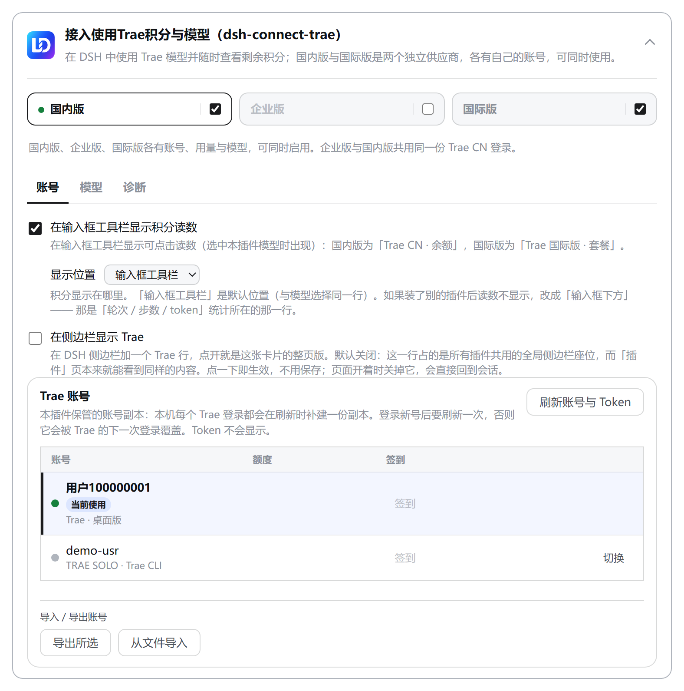
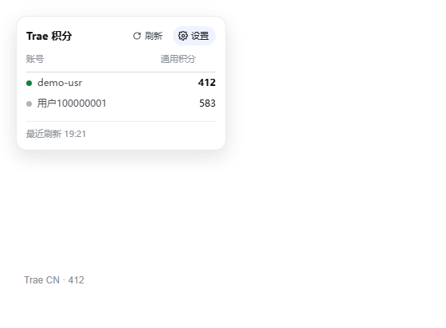
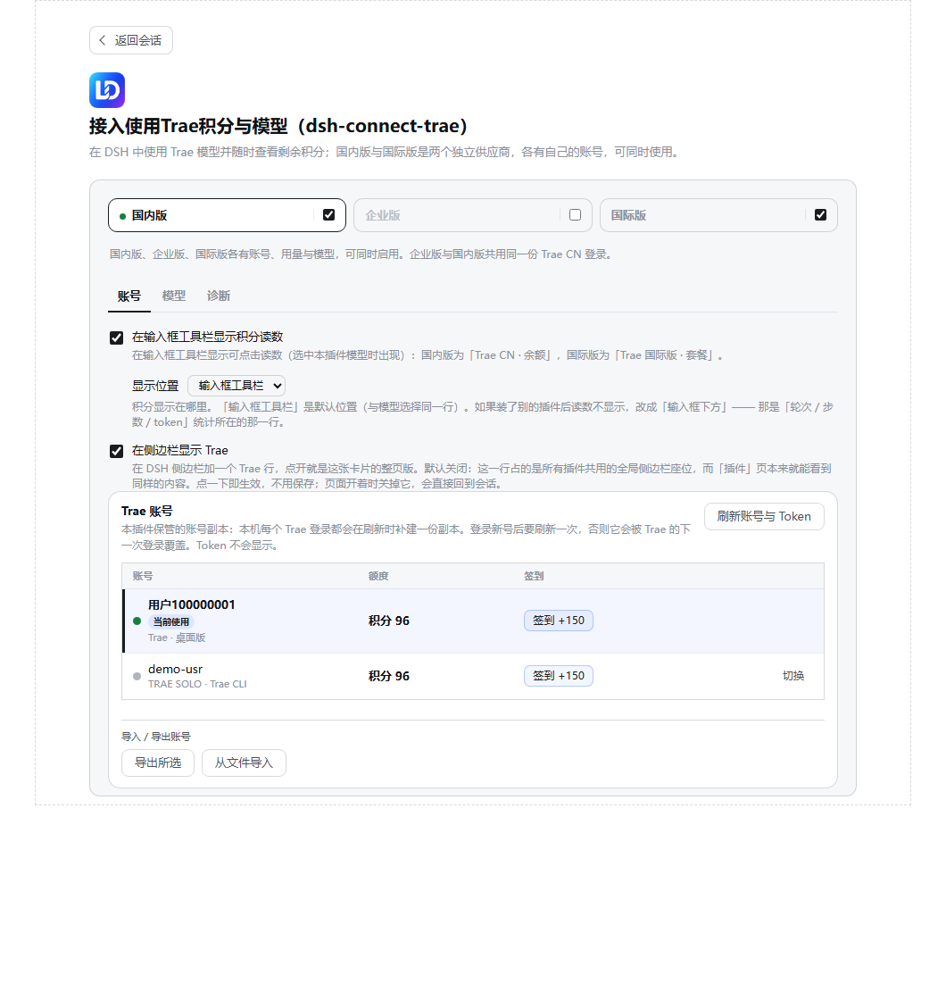

> 本轮说明：设置分为账号、模型、能力、诊断四页。下方截图为历史界面，当前文字以本地实现为准。历史宿主对照章节记录对应版本；当前开发依赖为 DSH 0.2.2-rc.1、pi-ai 1.3.0、schemastery 3.19.0。SemVer 对照表使用 `includePrerelease: true`。

> 本地维护：模块拆分、自检范围与验证结果见 [模块拆分记录](docs/MODULE-SPLIT-PLAN.md)，本地实体副本安装见 [部署记录](docs/LOCAL-DEPLOYMENT.md)。
此工作区来自 `kiwaro/dsh-connect-trae` fork，保留上游版权与版本。

<p align="center">
  
</p>

> 本文与配图中的账号名、额度与时间**均为演示数据**（`demo-*`），不含任何真实账号信息。

<h1 align="center">dsh-connect-trae</h1>

<p align="center"><b>把本机登录的 Trae 模型接入 DeepSeek Harness，并提供用量/积分概览与每日签到领取。</b></p>

<p align="center">
  <a href="README.en.md">English</a> ·
  <a href="#安装">安装</a> ·
  <a href="#工作原理">工作原理</a> ·
  <a href="#模型覆盖范围">模型覆盖范围</a> ·
  <a href="CHANGELOG.md">更新日志</a> ·
  <a href="https://github.com/dingminhua/dsh-connect-trae/issues">问题反馈</a>
</p>

<p align="center">
  <a href="https://www.npmjs.com/package/dsh-connect-trae"></a>
  <a href="https://www.npmjs.com/package/dsh-connect-trae"></a>
  <a href="https://github.com/dingminhua/dsh-connect-trae/actions/workflows/ci.yml"></a>
  <a href="LICENSE"></a>
  <a href="https://github.com/dingminhua/dsh-connect-trae/stargazers"></a>
  <a href="https://dshfind.com/plugins/dingminhua/dsh-connect-trae"></a>
</p>

一个独立的 [DeepSeek Harness (DSH)](https://github.com/deepseek-ai/deepseek-harness) bundle 插件。

它把本机已登录的 Trae 账号接到 DSH 的模型选择器，支持国内版、企业版与国际版。模型生成结构化工具调用，`bash` / `read` / `write` / `edit` 等工具由 DSH 在本地执行。

插件提供用量概览、每日签到与模型管理。国内版显示 Work 积分与积分余额，企业版提示到企业控制台查看租户额度，国际版显示订阅状态。

三个供应商分别为 `trae`、`trae-enterprise` 和 `trae-global`，可同时使用。在“设置 → Trae”中通过地区页签分别管理。

**支持 macOS、Windows 与 Linux**：CI 在 `ubuntu-latest` 与 `windows-latest` 上执行类型检查、测试及构建。Windows 的目录探测、应用版本头与锁行为有相应处理，详见 [Windows 说明](#windows-说明)。

> 读取账号状态、积分和模型目录不消耗模型积分。发送对话、账号池测试及生图会调用上游并可能消耗额度；签到领取和账号切换会写入相应状态。执行前请查看对应按钮的说明。

> **边界：账号、计费与模型请求由本插件独立管理。** 账号、凭据、模型目录、账号池与设置命名空间都只属于本插件；`trae` 失败不会借用别的插件的账号或额度，反之亦然。理由与具体含义见[与其它插件的关系](#与其它插件的关系)。

<a id="功能特性"></a>
## 1. 功能特性

- **三个供应商可同时使用**。国内版、企业版和国际版分别注册为 `trae`、`trae-enterprise` 和 `trae-global`，不同会话可以选择不同供应商。
- **企业版单独计费**。属于 `tob_online` 租户的 CN 凭据可用于个人版和企业版网关，两者分别消耗个人积分和企业额度。企业版默认关闭，启用前需确认账号具备企业权限。企业请求失败时不会改用个人额度重试。
- **各面板可单独启停**。关闭面板后，对应供应商从模型选择器撤下。重新启用时保留原有账号绑定、模型选择和上下文预算。国内版与企业版共用 CN 凭据池，但分别保存账号绑定和模型选择。
- **设置分为账号、模型、能力和诊断四栏**。账号栏管理登录、余额、签到和账号池；模型栏管理模型选择、图片输入、思考强度和上下文预算；能力栏管理积分显示位置、侧栏入口和生图开关；诊断栏显示供应商、服务账号、令牌到期时间、目录统计及最近错误。

  账号和能力设置立即生效，模型设置需要点击“保存”。切换分栏保留未保存的模型草稿和账号池日志。模型列表随页面展开，不设内层滚动条。

  凭据副本损坏后会改名留存，诊断栏列出留存文件及可恢复的账号数量。未登录页面也会显示这条通知，便于查找缺失的账号。
- **账号池：自动选号 + 失败换号（默认关闭）**。本机读完几个账号后，「该用谁的额度」可以交给插件按规则排序：**先排除不可用的**（凭据被拒、套餐不覆盖、账号已不存在、限流未到重试时间、额度耗尽），再在可用账号里**优先快到期的那点额度**（与其放着过期，不如先花掉），最后才比总额、token 新鲜度，并以账号 id 兜底成**全序**（同样的输入永远得到同样的顺序，不会在两行之间来回抖）。
  三个面板分别维护账号池。国内版与企业版共用 CN 凭据，但企业版只选择租户账号，国内版只选择个人账号。开启账号池后，插件先按上述顺序选择账号。请求发生凭据被拒、额度耗尽、限流或上游 5xx 等账号级失败时，会更换账号重试，最多尝试 3 个账号。模型 id 错误和请求参数不合法时不换号，因为切换账号无法解决这些问题，重复发送还可能增加费用。

  换号失败的真相会写进池的探针记录，下一次排序直接把它排到后面，而每一次结论都能在卡片上看到：`可用` / `限流` / `额度耗尽` / `凭据被拒` / `套餐不覆盖` / `上游不提供` / `本次未测出`，以及「什么时候可以重试」。

  **关掉池就回到严格绑定**，不会有任何残留 override。 卡片里的「全部测速」会把每个成员按目标模型各测一次，结果**边跑边显示**（一行一个答案，不等整批运行完成），并落盘成下次排序的依据。

  > 账号池默认关闭，启用后才会自动切换计费账号。卡片显示下一次实际请求将使用的账号，供你确认积分归属。

- **倍率内嵌模型名**。模型名称按 Trae 自身菜单的格式显示积分倍率（如 `GLM-5.2 · x0.79`），倍率随目录刷新更新。
- **活动优惠徽标**。Trae 把促销规则发在目录里（`activity_discount`：折扣比例、原价、闲时时段与时区），插件按**当前时钟**判定后，在模型名旁边画一枚胶囊：`5 折` / `闲时 5 折` / `限时 5 折`，悬停写明原价、现价与时段。
  判定放在**渲染时刻**而不是解析时刻，可重算本地时段；上游 current 快照可能滞后，不能保证隔夜立即撤下。 `current` 无折扣时继续检查 `off_peak` 时段。

  折扣来自上游活动字段；仅在活动提供结束时间时显示“限时”。 这是纯提示：不改请求、不改计费，国际区（订阅制）没有这项数据因此不显示。

  详见 [docs/PROMO_BADGE.md](https://github.com/dingminhua/dsh-connect-trae/blob/main/docs/PROMO_BADGE.md)。

  **同一枚胶囊也画在 DSH 的模型选择器里**（宿主 `conversation.input.model.label` 插槽），选择模型时即可查看对应积分信息。

  选择器里**倍率只出现一次**：名字里已有的目录倍率会被拆出来，有折扣时换成**折后价**（与卡片同一套时钟判定，同一份数据），打开选择器不会额外触发上游读。
- **DSH 本地工具循环**。通过 Trae `llm_utils_chat` 获取待执行的结构化 `tool_calls`，交由 DSH 自带的本地工具执行，再将工具结果回传模型。
- **文生图（`trae_draw_image`）**。把登录账号的 Trae 文生图能力接进会话：模型画一张图，插件把**图片字节一起取回来**、写进会话目录再显示给你。**默认关闭，各面板单独启用**。生成图片会消耗积分（实测 CN 个人版 `1920x1920` 一张约 8.8），因此需要单独授权，图片输入开关不会同时开启生图工具。协议、尺寸边界、取图那两步，以及为什么「取图」那条 GET 其实是又一次生成，见下方「[文生图](#文生图trae_draw_image)」。
- **国内国际双区域自动识别**。自动发现 Trae CN / TRAE SOLO CN / Trae / TRAE SOLO 四个本地安装的登录账号；区域由凭证自带的 `userRegion` 声明自动判定（host 后缀与 edition 标签兜底），无需手动指定。
  **美国区（`userRegion: "US"` / `*.traeapi.us`）目前「识别但不接入」**：插件不会把 US 凭据当成新加坡区发出去，而会在账号面板明确写「美国区（US）暂不支持」并列明账号，同时说明重新登录不会改变结果（issue #66）。
- **目录与勾选按面板隔离**。三个面板各一套模型目录、勾选、图片开关与上下文预算，各自读各自的槽位。模型目录从各面板对应的网关读取，以保留个人版和企业版各自提供的模型。
- **识图能力跟随 Trae 自身的标注**。Trae 把某个模型标为 `multimodal` 时，插件直接按多模态对外声明，无需你在卡片上逐一手勾（issue #16）。判据是「**你手动勾选的 ∪ Trae 标注多模态的**」：Trae 明确标 `false` 或未标注的模型保持纯文本，你可以照旧手动为它们打开图片输入。卡片上被自动开启的那一行显示为已勾选且只读，并说明原因。详见下方「图片输入（识图）」。
- **多账号切换**。支持重新读取 Token 列表并选择账号；Token 不写入 DSH 设置。
  **账号绑定会被保存**。账号池关闭时，额度耗尽或发现其他可用账号都不会触发自动切换。用户开启账号池后，插件按账号池规则选择计费账号。

  所以当绑定的账号额度耗尽时，卡片会**明确告诉你**，并把本机其他还有额度的账号连同其可用积分数列出来，供你选择切换；账号池关闭时不会自动更换账号。

  「刷新账号与 Token」每次都会回报结果（找到几个账号、当前仍绑定谁），不会再「点了没反应」。 下拉里显示的是产品名（`Trae` / `TRAE SOLO` / 国际版），便于分辨凭据来自哪个安装。
- **账号导入 / 导出**。不用再为了用第二个账号而把凭据手工写进默认路径、顶掉上一个。
  在卡片账号区的「导入 / 导出账号」里：**导出**勾选若干账号下载一份 JSON；**导入**选择文件后先看**脱敏预览**（只显示账号标识与「是否有 Token」，不含凭据本身）再勾选导入。

  文件字段格式与 `dsh-connect-workbuddy` 兼容，但 WorkBuddy 凭据不能据此登录 Trae。 导入还需通过 Trae 区域及凭据检查。

  导入按账号去重（同一账号再导入即覆盖更新），**无法识别区域或缺少 Token 的记录会被跳过并计数**。国内版与国际版使用独立计费通道，跨区导入会导致跨区计费，所以这里只认同能**正向识别**的区域（企业版共用 CN 凭据池，不构成第三条导入通道）。

  导出文件里是**有效 Token，请当作密码保管**。 （issue #37）
- **只读用量与模型管理**。国内版查看 Work 积分与积分余额，国际版查看订阅/试用状态；刷新/启用 Trae 模型；只读查询不消耗额度。
- **每个模型的思考强度可选，默认档不再显示成 `Default`**。Trae 的目录一直在发布每个模型自己的默认档，插件也一直解析进了目录，但**从没报给 DSH**，所以模型选择器只能说 `Default`：既看不出这个模型会跑哪一档，也没法固定成别的档。
  现在适配器把默认档报上去，宿主会把它物化进每一个没有指名档位的请求，模型栏里每个声明了档位的模型都多一个下拉，第一项写的正是**它实际会跑的档**（例如「默认（high）」）。

  取值优先级是**你选的 > 上游默认 > 该模型自己的中档**；选「默认」是把这个键**删掉**，而不是存一个恰好等于今天默认值的档（后者看着一样，却把选择明确约束了，上游改默认时就不再跟随）。

  保存的档位若已被目录撤回，将被忽略，以免 DSH 返回 `UNSUPPORTED_REASONING_EFFORT`。

  不选任何东西时行为与之前完全一致。
- **积分临近到期会提醒**。剩余额度只回答「还有多少」，回答不了「**哪一笔先到期**」；提醒条按到期紧迫程度逐级加重（**7 天 → 3 天 → 24 小时 → 已过期**），写明金额、套餐数和最早到期时间，避免只盯总额时悄悄丢掉最先到期的额度。国内版在用量页与输入框积分面板两处都显示（国际版是订阅制，没有逐包到期数据）。
- **一键测试启用模型**。给**已启用**的每个模型发一条最小消息（一句 `ping`、不带工具），逐个告诉你能不能真的应答：**可用** / **需要更高档位**（Trae `1005`，你的套餐不覆盖）/ **上游不提供**（`4001`，SOLO 通道没有这个模型）/ **被限流**（`4011`，Trae 限了这条通道）/ **登录凭据被拒** / **本次未测出**。
  超时、断连、代理错误和 5xx 均显示为未确定。只有上游明确拒绝模型调用时，才判定不可用。
  模型测试由你点击触发，会消耗额度；账号池测试、对话和生图也可能消耗积分。
  测试结果留在当前会话，不写入设置。
  > `4011` 是**限流**不是「模型不可用」（issue #33 实测）：它额度耗尽走的是另一个码 `4008`，所以「额度还有很多却报 4011」两句话可以同时成立。可保留模型并稍后重试；具体恢复时间以上游响应为准。
- **一键测试所有模型**。同一套探测，作用于当前 region 的**全部可见模型**（不限于已启用的）。套餐降级或 Trae 调整模型目录后，可用此操作检查尚未启用的模型。
- **每日签到领取（逐账号）**。国内版**每个账号行各有一个签到按钮**，当日奖励直接写在按钮上（`签到 +150`）；该账号当天已领显示「已领取」，**本机今日名额已被别的账号用掉**时显示「本机已签」。两种状态分别表示当前账号已领取，或本机名额已被其他账号使用。
  签到由你主动点击触发；一次点击只针对该行账号、只发一次请求。 Trae 的签到按「**每台设备每天一次**」计（换账号不会重置当天名额），所以逐账号签到始终是主路径。

  账号池里另有一个「全部签到」，它**不是**把同一件事盲目重复：一旦上游回 `9095`（本机今日已领），整批立刻停止并把剩余账号如实标成「本机已签」，避免将未执行的账号记成签到失败。

  国际版没有签到活动，因此不显示该按钮。
- **输入框积分与账号切换**。在“能力”页开启读数后，国内版状态栏显示 `Trae - CN · 余额`，弹窗标题为“Trae - CN积分”，积分列读取通用积分余额；国际版显示套餐。选择其他供应商模型时，仍显示已启用 Trae 区域的读数。弹窗包含账号、积分（国际版为套餐）和操作三列，当前账号按钮显示“使用中”，其他账号显示“切换”，提交期间显示“切换中…”。打开弹窗、切换账号及每 5 分钟自动刷新余额。右上角“刷新”会测试账号池勾选成员，可能消耗积分；“设置”打开本插件设置页。

  

  在“能力”页选择输入框工具栏或输入框下方统计行。位置按区域保存。Trae 与 WorkBuddy 同时加载到工具栏时，共用临时排序占位，先加载的保留原位，后加载的向左排列；卸载后释放占位。该占位仅协调显示顺序，不共享账号、凭据或额度。

- **可选侧栏入口**。在“能力”页开启“在侧边栏显示 Trae”后，侧栏显示 Trae 入口，打开同一套区域和账号、模型、能力、诊断页面。默认关闭，开关立即保存；关闭已打开的侧栏页面后返回会话。
  


- **安全 loopback shim**。每区域一个随机端口 + 进程内随机 secret，真实 Trae token 不交给 pi-ai。

在“更多设置 → 图标样式”中可切换 Claude 风格线条图标和默认图标。默认使用 Claude 风格，选择立即生效，并由当前浏览器分别保存每个插件的设置。

### 每日自动签到

国内版账号池支持每日自动签到，默认关闭。开启并保存后，插件在 DSH 运行期间为勾选的个人账号签到，重启后保留当天进度，失败自动重试。此开关独立于账号池的自动挑号开关。Trae 对每台设备的每日奖励设有限制，不能保证每个成员都能领取。国际版与企业版不提供此功能。

<a id="工作原理"></a>
## 2. 工作原理

```text
DSH PiAiAdapter（每个 provider 一套）
  -> 安全 loopback shim（每区域一个随机端口 + 进程内随机 secret）
  -> TraeSoloBridge
  -> 国内版 https://trae-api-cn.mchost.guru/api/agent/v3/llm_utils_chat
  -> 企业版 https://console.enterprise.trae.cn/api/agent/v3/llm_utils_chat
  -> 国际版 https://coresg-normal.trae.ai/api/agent/v3/llm_utils_chat
  -> Trae SSE / pending function_call
  -> OpenAI SSE tool_calls
  -> DSH 本地执行工具并回传结果
```

每个面板分别维护凭据存储、模型目录、协议映射、上游客户端、回环服务和适配器，并按凭据的区域声明筛选账号。因此多个区域可以同时在线，供不同会话使用。

**面板不是区域。** `cn` 与 `ai` 恰好与两个区域一一对应，但企业池共用 `cn` 凭据却计费到另一个账户、供另一份名录，因此企业版需要独立的开关、账号绑定和模型选择。把面板与区域分成两个概念，`enterprise` 就能用同一套设置管道处理，存储形状不变：它只是 `regions` 映射里的又一个槽位。

国内区因此并列发布两个 provider，**路由在构建 provider 的客户端时固定**，不存在「按调用猜一次」：shim 为每个 provider 提供一条 bearer 路由并按 bearer 分派，未知 token 直接 401，不会退回第一条路由。

企业网关要求每次调用带 `session_id`，而个人版网关会拒绝带它的请求体，所以只在该路由上加。

用量概览走 `https://api.trae.cn/trae/api/v2/pay/*` 与 `/trae/api/v2/ug/*` 只读接口（国际账号走其自有网关的订阅状态端点）；在这些用量与签到接口中，每日签到领取会写入领取状态，走 `POST /trae/api/v2/ug/checkin_credits/claim`，需要携带本机安装的设备号（`x-device-id`，与聊天通道同源）。

该设备号也正是签到「每台设备每天一次」的判定依据，所以换账号不会重置当天名额。 刷新得到的 token 按区域存放在 `$DSH_HOME/.trae-auth.cn.json` 与 `$DSH_HOME/.trae-auth.ai.json`（两个账号同时在线互不覆盖；旧的单文件 `.trae-auth.json` 作为迁移来源保留读取）。

> 详见 `docs/IMPLEMENTATION_PLAN.md`、`docs/SOLO_ROUTE_DECISION.md`、`docs/USAGE_API_RESEARCH.md`。

<a id="与其它插件的关系"></a>
## 3. 与其它插件的关系

账号、凭据和请求调度保持插件内隔离；工具栏显示顺序与 WorkBuddy 使用同一个临时占位表。

- **业务状态独立。** 账号、凭据、模型目录、账号池、访问令牌、设备号都只属于本插件；插件只读写自己的文件（`$DSH_HOME/.trae-auth.*.json`、`.trae-auth.deleted.*.json`、`.trae-pool.*.json`）与自己的设置命名空间，不读取其他插件的账号或计费数据；工具栏显示顺序使用共享临时占位表。它确实会编辑 Trae 桌面应用自己的登录文件，但那是另一个**应用**，不是另一个插件。
- **不做跨插件的账号或额度调度。** 账号池只在本插件自己的账号之间排序与换号；`trae` 失败就是失败，不会去「借」另一个连接器插件的账号、额度或通道，也不会把请求转交给别的插件重试。本插件不提供跨插件请求代理接口。
- **显示顺序协调。** 两个连接器在同一渲染进程中使用 `Symbol.for("dsh-connect.composer-orders.v1")` 保存已占用的排序值。后注册者减小排序值向左排列，注册失败或卸载时释放。该表不包含业务或账号数据。
- **不共享开关。** 关掉本插件的某个面板，只撤下本插件的 provider 与请求，不会改动另一个插件的供应商、模型、绑定或设置。

**为什么立这条边界。** 插件之间一旦互相依赖，任何一个插件的升级、卸载或版本线变化，都会悄悄改变另一个插件的行为；而 DSH 的加载顺序、多版本并存与用户自定义 profile 让这种耦合无法可靠表达。立住这条边界，「出问题的是谁」永远可以定位到**一个**插件，而不是一串。

> 跨插件复用仅限公共界面规则和工具栏排序。账号、模型调用、积分及设置分别由各插件管理。

<a id="图片输入识图"></a>
## 4. 图片输入（识图）

插件对外声明「这个模型是否接受图片」，DSH 据此决定附图是**原样发出**还是**降级成文字描述**。所以这条声明是硬开关，不是一个无关紧要的标记。

判据是**两个来源的并集**（issue #16）：

| 来源 | 含义 |
|---|---|
| Trae 目录自带的 `multimodal` 字段 | Trae 自己对「这模型读不读图」的回答。Trae IDE 本体的附图按钮就是纯粹由这个字段驱动的，没有用户开关 |
| 你在卡片上手动勾选的 `imageModelIds` | 显式选择。即便 Trae 后来不再标注该模型，你的勾选也不会被撤掉 |

要点：

- **只有 `multimodal === true` 才自动开启。** 字段缺失（旧版本保存的目录、兜底目录）或明确 `false`，都不会自动开启图片输入；用户仍可手动开启。
- **自动开启并不等于自动发图。** 它只是让 DSH 允许你给该模型附图；图片始终由你在对话里自己贴，插件不会替你发送任何东西。
- **被自动开启的行在卡片上显示为已勾选且只读。** 因为并集语义下取消勾选会被立刻重新加上，因此该行不提供取消操作。目前不为单个模型提供「强制关闭」的出口；如果你需要这个开关，可以在 issue #16 下提出。
- 手动勾选对 Trae 标注 `false`（或未标注）的模型依然有效，可用于上游尚未标注但已确认支持图片的模型。

<a id="文生图trae_draw_image"></a>
## 5. 文生图（`trae_draw_image`）

插件接入 TraeWork / SOLO 的文生图服务。在会话里让模型**画一张图**，插件把图片字节取回来、保存为会话目录里的文件，再按相对路径显示在聊天里。取图走 `get_resource_url` 解析签名地址，用于下载已有图片，不会再次生成。历史请求与计费验证见下表。

**默认关闭，按面板单独开。** 生图**真实消耗积分**（实测 CN 个人版 `1920x1920` 一张约 8.8 积分），开启后模型可以主动调用计费服务。卡片能力栏勾上「允许模型自主生图」（`drawImageEnabled`），该面板的 `trae_draw_image` 才注册进 DSH；取消勾选立即撤下。

生图开关按面板保存。企业版和国际版使用不同计费通道，尚未验证生图行为，因此不提供此功能。

以下记录来自当次接口实验，当前可用性和费用以上游实际响应为准：

| 项目 | 事实 |
|---|---|
| 端点 | `POST /api/ide/v1/tool_text_to_image`（另有 SSE 变体 `..._stream`），模型 `seedream_5` |
| 请求体 | 只有 `{prompt, image_size?}`。多带已知字段（`mode_type` / `session_id` / `image_urls` / `watermark`）网关返回 HTTP 400 且 body 为空；测试中的未知字段被忽略 |
| 成功响应 | 扁平结构 `{"message":"success","uri":"tos-cn-i-…/cn/<uid>/gen_image/<ts>_<hex>_jpeg_1920x1920"}`，**没有** `{code,msg,data}` 信封 |
| 尺寸 | 总像素必须落在 **3686400 ~ 16777216**：`1024x1024` 太小被拒（`code 3003`，未生成图片；响应未提供扣费回执）、`4608x4608` 太大被拒；预设 `2k`/`3k`/`4k` 可用，缺省 `1920x1920` |
| 取图 | **分两步下载已有图片**：`POST /api/ide/v1/get_resource_url`，body 只能是 `{"uri_list":["<key>"]}`（`{uri}`/`{path}`/`{resource_uri}`/`{uris:[…]}`、GET `?uri=` 都只回 200 + 空 `url_map`），应答 `{"url_map":{"<key>":"<byteimg 签名 URL>"}}`；再直接 GET 那个签名地址（**不带任何 Trae 头**，签名在 query 里）取得图片字节；历史实测为 `image/jpeg`、1,155,578 字节、头 `ffd8ffe0` |
| 那条 GET 的真实身份 | 决定性探针：POST 拿到 `…/1792954795741_44f94116_jpeg_1920x1920` 后，用同一 `(prompt, size)` 打 GET，回来的是**另一个** uri（`…/1792954810505_b107ac11_jpeg_1920x1920`），耗时 27 秒、未返回图片字节。该 GET 再次生成并扣费（两次共约 17.6）。非法尺寸探针（`100x100`）也印证：报错直接来自 Ark 的 `[callArkImageGeneration]` |

**工具返回本地图片文件。** 工具成功时返回 `url`（Trae 对象 key，留作排障）、`path`（相对会话目录的本地文件，如 `trae-images/trae-20261026-042015-ab12cd.jpg`）、`model`、`prompt`、`size` 和一句 `hint`；渲染层输出 ``。DSH 按会话工作目录解析相对路径，再通过 `api/file` 鉴权路由读取并显示图片。

只有字节真的没拿到时（`IMAGE_UNAVAILABLE`：图已生成，生成请求可能已计费）才退化成「只有对象 key」的行内代码；这种失败也会触发 30 秒本地冷却。重新调用生成工具会创建新图片，并可能再次计费。

**改图与文生视频没有放开。** 改图需要先申请 TOS 上传预签名；本插件尚未实现该链路；视频要轮询素材结果，是另一条异步管线。两者都尚未实现，因此设置页不提供入口。

<a id="模型覆盖范围"></a>
## 6. 模型覆盖范围

插件提供的是 Trae **SOLO 通道**的模型（`DeepSeek-V4-Flash-Official`、`DeepSeek-V4-Pro-Official`、`GLM-5.3`、`GLM-5.2`、`Kimi-K3`、`MiniMax-M3`、`Qwen3.8-Max`、`Doubao-Seed-*` 等），三个面板均走这条通道。

企业池另有一份名录（例如 `DeepSeek-V4.1-Flash` 只有企业池列），所以两边勾选互不覆盖。

以下 2 个模型目前来自 **TraeCode（Trae IDE）通道**，尚未开放到 SOLO 通道：

| 模型 |
| --- |
| `kimi-k2.8-preview` |
| `qwen3.8-flash` |

它们**会出现在模型列表里**（Trae 的目录列出了它们），但插件侧暂时没有可调用它们的通道。选中后发送消息会得到一条**明确的错误**，例如：

```
Trae does not serve this model under the SOLO function the request used
(config_name rejected) · Trae code 4001 · upstream: We're sorry, the param is invalid…
```

即「上游不提供该模型」被如实说明，而不是静默失败或像网络故障。上游开放 SOLO 调用且目录字段仍兼容时，刷新目录即可尝试使用；若协议变化，仍需升级适配。

> **同一条报错的另一种成因（3.5.1 已修，issue #38）**：`DeepSeek-V4` 四行曾报**同样的 4001**，原因是调用 id 被错误改写：
> 它们在上游名单里**本来可以调用**，只是 CN 区的 wire 把同一族列了三行且共享展示名，旧代码让**最后**一行
> （元数据残缺的小写行 `deepseek-v4-flash`）抢走了展示名键，桥接层据此把 `config_name` 改写成小写拼写，
> 上游拒收。**判别方法**：检查上游调用 id 与实际请求的 config_name 是否一致；存在 id 但返回 4001 时，不能仅据此断定原因。
> 3.5.1 起两张映射表都改为先到先得，不再发生改写，四行已实测恢复正常。

> **为什么现在会显示（2026-10-02 起的策略）**：此前这类「目录里有、但拿不到调用 id」的模型会被**直接隐藏**，理由是「放出来只会报错」。可调用名单按账号档位下发，因此免费账号的检查结果不能代表付费账号（issue #19 的报告人就是 Pro：他的账号能调用本机免费账号被兼容性检查挡住的模型）。插件保留目录中的模型，并在调用失败时显示实际错误。

> deepseek-v4.1-flash 曾在此列。`docs/DS41_CALLABILITY.md`（2026-09-15 取证）实测 8 个 SOLO function
> 全部返回 `4001 param is invalid`。**上游后来把它开放到了 SOLO 通道**：当前实时目录里它带
> `wireFunction: solo_work_remote`，可正常调用（已实测刷新确认）。文档此前未同步，现已从表中移除。

> `glm-5.3-flash` 同样曾在此列，**4.4.0 起已移除**：上游后来开放了它，当前实时 wire 名单里它带
> `wireFunction: solo_work_remote`（实测）。该模型此前已在目录中。不能调用的原因是
> Remote 目录列出了它而 wire 名单没有，于是既拿不到调用 id、也从未进入可调用名单；
> 4.4.0 修好了「wire 有而目录没有」与「目录问了但没问全」两处之后，它作为**普通可调用模型**出现。

> 注意区分：**`GLM-5.3` 是支持的**（走 SOLO 通道）。glm-5.3-flash 也已支持。
> 它与 `GLM-5.3` 始终是两个不同的模型，但前者已开放到 SOLO 通道。

如果你现在就要用这 2 个模型，请直接在 **Trae IDE 本体**中使用。

<a id="最大输出与上下文预算"></a>
## 7. 最大输出与上下文预算

模型卡上的「最大输出」来自 Trae `get_detail_param` 的 model_detail_list[].max_tokens。历史国内版实测中，80 个 config 均提供该字段。

4.0.1 起它随目录合并一路带到卡片、`/models/refresh` 与 DSH 模型注册；此前合并层漏传了这个字段，整区模型全部显示空白（issue #42，诊断见 `docs/ISSUE42_DIAGNOSIS.md`）。

**缺少元数据的行保持空白**：目录里有、但 SOLO 名单里没有对应 config 的模型（上面那 2 个 TraeCode 通道行）拿不到任何候选值，宁可空白也不编一个上限。

这个值是元数据，插件不把它写进请求体（输出上限由 Trae 服务端决定）。

上下文窗口在 Trae 公布的默认（dev）档与 Max 档之间选，**4.4.8 起对宽窗模型多一个 500K 中间档**，按面板逐模型存成 `contextBudgets`。

500K 是插件提供的中间档，并非上游公布的窗口：dev 常见 200K/256K/272K，Max 常见 1M，从默认直接跳到 Max 是 5 倍，而 1M 的计费并不是每个会话都用得上。

只有 500K 大于 dev 且小于 Max 时才显示此选项。`applyContextBudgets` 用**同一条规则**（`contextBudgetOptions`）校验，落盘值不是该模型可选窗口就一律退回 dev 档，绝不会把模型撑到它没有的窗口（比如某模型后来被上游把 Max 调到 256K，旧的 500K 会安静地失效而不是溢出）。

想整区一次切换：模型管理区有「**整区切到 500K**」（给本区所有 Max ≥ 500K 的行写入 500K，其余不动）、「**整区切到 Max**」（给每个带 Max 档的行写入其 `maxContextWindow`，没有 Max 档的行不动）和「**全部恢复默认上下文**」（清空本区预算）三个按钮，作用在草稿上、按「保存」生效，与逐行单选落盘的结果完全一致（issue #42 的历史场景中，国内版有 18 个 Max 模型，逐行设置需操作 18 次）。

<a id="安装"></a>
## 8. 安装

推荐使用 DSH 插件命令安装 npm 已发布版本：

```sh
dsh plugin --profile desktop add dsh-connect-trae
```

或直接通过 npm 安装：

```sh
# 在目标 DSH profile 目录中执行 / Run inside the target DSH profile directory
npm install dsh-connect-trae
```

安装、更新或卸载 bundle 后，需要重启对应的 DSH 进程。

<a id="dsh-版本兼容"></a>
## 9. DSH 版本兼容

**要求 DSH 0.1.7-rc.1 及以上**（2.3.0 起不再支持 0.1.7 之前的宿主；peer 依赖范围已按此限定）。
**peer 上界为 `<0.3.0-0`：0.1.7 与 0.2 两条线均受支持（含 0.2.2-rc.1，已实测）。**

<a id="同时支持-pi-ai-的两代上下文342-起"></a>
### 9.1. 同时支持 pi-ai 的两代上下文（3.4.2 起）

DSH 自己横跨 `@earendil-works/pi-ai` 的两代，而**本插件解析到哪一代由你的安装环境决定**，
可能与 DSH 使用的版本不同。两代上下文格式如下：

| | 旧代（≤0.85） | 新代（0.86+） |
| --- | --- | --- |
| 形状 | `{ systemPrompt, tools, messages }` | `{ messages: [ {role:'system', content, toolsAdded}, … ] }` |
| 系统提示 | 顶层 `systemPrompt` | **只**挂在那条 system 消息上 |
| 工具声明 | 顶层 `tools` | **只**挂在那条 system 消息的 `toolsAdded` 上 |

错配**两个方向都会坏**，所以 3.4.2 起插件会按自己解析到的那一代双向适配（issue #27）：

- **新版 DSH + 旧库**：旧代的 token 估算没有 `role === 'system'` 分支，会去迭代一个字符串并抛
  `Cannot read properties of undefined (reading 'length')`。这一步在请求构造之前，所以表现为
  「任意模型都崩、耗时极短、usage 恒为 0」。
- **旧宿主 + 新库**：不崩，但现代 api 只读那条 system 消息，顶层字段会被忽略，导致系统提示与
  **全部工具声明**丢失（模型永远不会产生 toolCall）。这类故障更隐蔽，同样已修。

代际判据是**本插件自己解析到的那份包**（读它的 manifest 版本；读不到时看包布局），
因为插件目录中的嵌套副本可能优先于 DSH 提供的副本被解析。启动时日志里会有一行
`dsh-connect-trae: pi-ai <版本> (<代数>)`，`legacy` 表示你这份安装解析到了 ≤0.85 的旧代。

分界线是 **0.86**：`dist/utils/transcript.js`、`normalizeContext`、估算器的 system 分支、
以及「不再读顶层字段」这四件事同时出现在 0.86.0。按 `0.87` 划分会把 0.86.x 误判成旧代而错误折返，
反而丢掉提示与工具。

历史逐符号核对确认，0.2.0 线中插件使用的 API 保持不变（[完整的 0.2.0-rc.1 影响面核对](https://github.com/dingminhua/dsh-connect-trae/blob/main/docs/DSH_0.2.0_RC1_IMPACT_CHECK.md)）。

但 0.1.7 起 DSH 有一道**bundle 级 peer 兼容性检查**： peer 范围不满足的 bundle 会被**整体跳过**，只往 stderr 写一行，界面上表现为「插件凭空消失」。

<a id="dsh-021-线pi-ai-110同步结论"></a>
### 9.2. DSH 0.2.1 线（pi-ai 1.1.0）同步结论

宿主 `0.2.1-rc.1` 把 `@earendil-works/pi-ai` 从 `^0.85.1` 抬到了 **`^1.1.0`**（`0.2.1-rc.2` 起至 `0.2.1-rc.5` 均保持不变），这是 0.2 线里
唯一有实际行为影响的变化。三项结论：

1. **请求体没有丢东西（已实测）**。1.1.0 的 api **只**读 transcript 里的 system 消息，
   顶层 `systemPrompt` / `tools` 完全不再读取；而 `dsh-llm-pi-ai` 的 `piContext()` 仍然产出 旧版信封。

   本插件 3.4.2 起提供双向适配。历史测试将 DSH 上下文交给 pi-ai 1.1.0，再通过本地 SSE 服务捕获请求体，得到 `roles: ["system","user"]`、system 文本完好、 `tools: 1`；**去掉适配则变成 `roles: ["user"]`、system `null`、`tools: 0`**（不报错）。

   这条对照已固化为 `tests/pi-ai-context.spec.ts` 的线上请求体矩阵。
2. **类型面补齐**。1.1.0 把 `ProviderStreams` 的第二参改成带 `unique symbol` 品牌标记的
   `TranscriptContext`，只有 `normalizeContext()` 能产出。适配层在这条边界上做一次显式转型
   （`src/adapter.ts` 的 `withContextAdaptation`），并在两处调用点写明为何品牌在此处不可诚实获得。
3. **peer 范围无需改动**。DSH 用 `semver.satisfies(runtime, range, { `includePrerelease: true` })`
   求值，且只校验 `@deepseek-ai/dsh*` 命名空间，因此 `>=0.1.7-rc.1 <0.3.0-0` 对 `0.2.1-rc.1` 至 `0.2.1-rc.5` 均已判通过
   （已实测）。**注意**：普通 semver 默认选项会排除部分预发布版本。早期 `dsh-connect-workbuddy` 侧
   调研文档描述了该现象；DSH 的实际校验使用 `includePrerelease: true`。

当次开发树的 `@earendil-works/pi-ai` 钉在 **1.1.0**（宿主实际随包的版本，`0.2.1-rc.5` 实测仍是 1.1.0）而非 `^1.1.0`，
使本地 typecheck 与测试运行在与用户完全一致的契约上；`schemastery` 的 override 同步抬到
`3.18.5`（`dsh-llm-pi-ai@0.2.1-rc.5` 声明 `~3.18.5`）。

<a id="021-rc3-同步结论446-起"></a>
### 9.3. `0.2.1-rc.3` 同步结论（4.4.6 起）

宿主推进到 `0.2.1-rc.3`（桌面版 `CFBundleVersion` 与随包 `dsh-desktop-runtime` 同为 `0.2.1-rc.3`）。

上游这一版只实施了 5 个提交，其中 3 个是 UI 的「导航项自定义」（插件化面板的固定/取消固定、 More 菜单、埋点），1 个是 DeepSeek API-key 通道改走官方 `/models` 目录，1 个是版本号。

对**本插件**而言：

- 插件调用的 13 个宿主包里，**只有 `dsh-client-ui-primitives` 有代码变化**，且**全是新增**：
  `Tooltip` 的 `TooltipSide` 增加 `'left'` 并改用实测边框盒做「首选 → 对侧 → 垂直侧」的换边放置， `MenuItemButton` 增加 `current`、`Menu` 增加 `minWidthFromAnchor`，图标新增 `IconAppsAddOutline*`。

  本插件对 `dsh-client-ui-primitives` 只有**类型层引用**（`import type {} from ...`）， 运行时不碰这些组件，**无需任何适配**。
- 其余 12 个包（`dsh-llm`、`dsh-llm-pi-ai`、`dsh-settings`、`dsh-host-webserver`、`dsh-atomic-write`、
  `dsh-home-paths`、`dsh-attachment`、`dsh-client-ui-renderer`、`dsh-client-ui-settings`、
  `dsh-client-ui-settings-plugins`、`dsh-client-ui-slots`、`dsh-client-locale`）**逐字节未变**。
- 插件注册的全部槽位（`plugins.bundle.config`、`plugins.row.config`、`conversation.input.right`、
  `conversation.composer.dock`、`conversation.input.model.label`）在 rc.3 中**仍然存在且契约未变**；
  宿主新增的 `conversation.session.header.views.actions` 等槽位与本插件无交集。
- peer 范围**无需改动**：`0.2.1-rc.3` 对 `>=0.1.7-rc.1 <0.3.0-0` 已判通过（已实测）。

细节见 [`docs/DSH_0.2.1_RC1_SYNC.md`](https://github.com/dingminhua/dsh-connect-trae/blob/main/docs/DSH_0.2.1_RC1_SYNC.md) 第十节。

<a id="021-rc5-同步结论466-起"></a>
### 9.4. `0.2.1-rc.5` 同步结论（4.6.6 起）

宿主推进到 `0.2.1-rc.5`（经停 `rc.4`）。两版之间的 13 个提交里，约 240 个文件只是各包
`package.json` 的版本号行，**有实质代码的只有四处**：ACP/MCP 把目录加载诊断从 stdout 改到
stderr、View 标签的 tooltip 只在文字溢出时显示、More 菜单 tooltip 去掉动态文案、
以及 thinking 区块的自定义渲染。

对**本插件**而言：

- 插件调用的 13 个宿主包在 rc.3→rc.5 之间**逐字节相同**（含 rc.3 时唯一有过变化的
  `dsh-client-ui-primitives`，本版它没有变化），因此**零适配**。
- rc.4 唯一的行为变化是 `conversation.chat.reasoning.body` 槽位新增 `rawText`、`text` 改为
  「显示用文本」（会剥掉 `<signature>` 前缀）。本插件全仓不注册或调用任何
  `conversation.chat.*` 槽位，**不击中**。
- rc.4 把诊断日志赶出 stdout 的理由是「ACP 保留 stdout」。本插件宿主侧**从不用 stdout**
  （无 `console.log/info/debug`、无 `process.stdout.write`），诊断走卡片自己的诊断面板，
  因此这条**已是满足的前提**，不是需要跟随的范式。
- 插件注册的全部 5 个槽位在 rc.5 中**仍然存在且契约未变**。
- peer 范围**无需改动**：`0.2.1-rc.4` / `0.2.1-rc.5` 对 `>=0.1.7-rc.1 <0.3.0-0` 均已判通过。

细节见 [`docs/DSH_0.2.1_RC1_SYNC.md`](https://github.com/dingminhua/dsh-connect-trae/blob/main/docs/DSH_0.2.1_RC1_SYNC.md) 第十一节。


<a id="022-rc1-同步结论481-起"></a>
### 9.5. `0.2.2-rc.1` 同步结论（4.8.1 起）

宿主推进到 `0.2.2-rc.1`。这一版**不只是版本号**：随包依赖整体换代（`cordis` 4.0.5 →
**4.1.0**、`schemastery` 3.18.5 → **3.19.0**、`@earendil-works/pi-ai` 1.1.0 → **1.3.0**），
插件调用的 13 个宿主包里 **8 个有实质变化**。

对**本插件**而言：

- **唯一的契约破坏**：`dsh-llm-pi-ai` 给 `ResolvedPiAiProviderProfile` 新增了两个**必填**
  字段 `maxRequestImages` / `imageOffloadCountQuantum`。本插件从实时目录**手工构造**这个
  profile（不走宿主的配置解析），所以升级依赖后 `pnpm typecheck` 报 `TS2739`。已在
  `REQUEST_IMAGE_BUDGETS` 补上宿主默认值 `50 / 10`。
- **运行期原本就没坏**：宿主只在配置解析路径里给这两个字段兜底，手写 profile 传
  `undefined` 时 0.2.2 走「不限制张数」，因此 4.8.0 在 0.2.2 上照常工作（本机实测：桌面端
  0.2.2-rc.1 + 插件 4.8.0，`GET /plugins/dsh-connect-trae/usage` 返回 200 且 `signed-in`）。
- **新增能力按需采纳**：目录变化时按 provider 发 `llm/models-updated`（签名去重，避免每次
  设置写入都惊动选择器）；`conversation.input.model.label` 是 `single` 槽，本插件占住后会
  压掉宿主的「名字 + `model.badge`」内置渲染，因此对**别的 provider** 的模型补回了 badge
  （含语言回退），本插件自己的行行为不变。
- **明确不采纳**：新语言 ja / es / fr / de / ru / pt（只维护 zh / en，其余回退英文）、
  `llm-pi-ai/request-headers`
  （不需要额外请求头）、`supportsMidConvoEffort`（openai-completions 路线用不到）。
- **核心功能验证**：双区域供应商、用量与积分概览、每日签到领取的对应测试通过。该次升级
  只碰图像预算、目录公告与模型标签三处。
- 其余 6 个有变化的包（`dsh-host-webserver` 的资源路由、`dsh-attachment` 的准入类型扩展、
  `dsh-client-locale` / `dsh-client-ui-settings-plugins` 的新语言、`dsh-client-ui-settings`
  的 icon 槽位、`dsh-client-ui-primitives` 的新增属性）**全部是新增**，本插件未使用或已有
  等价实现；`dsh-atomic-write` / `dsh-client-ui-renderer` / `dsh-client-ui-slots` /
  `dsh-home-paths` / `dsh-settings` 这 5 个包**逐字节未变**，槽位契约不变。
- peer 范围**无需改动**：`0.2.2-rc.1` 满足 `>=0.1.7-rc.1 <0.3.0-0`，
  `tests/dsh-peer-range.spec.ts` 的 `MUST_ADMIT` 已补入。

细节见 [`docs/DSH_0.2.2_RC1_SYNC.md`](https://github.com/dingminhua/dsh-connect-trae/blob/main/docs/DSH_0.2.2_RC1_SYNC.md)。

<a id="peer-上界为什么不写-020"></a>
### 9.6. peer 上界为什么不写 `<0.2.0`

2.3.1 曾写 `<0.2.0-0`，意图是「先不支持 0.2.0 正式版」。这个写法**是错的**：
SemVer 里 `0.2.0-rc.1 > 0.2.0-0`，于是它把**整个 0.2.0 预发布线**也一并排除，
用户装上第一个 0.2.0 预发布版后插件立即整体失效（2.3.1 的实际故障）。

| 写法 | 0.1.7 线 | 0.2.0 alpha/rc | 0.2.0 正式 | 0.3.0 |
| --- | --- | --- | --- | --- |
| `>=0.1.7-rc.1 <0.2.0-0` ❌ | ✅ | ❌ | ❌ | ❌ |
| `>=0.1.7-rc.1 <0.2.0` | ✅ | ✅ | ❌ | ❌ |
| `>=0.1.7-rc.1 <0.3.0-0` ✅ | ✅ | ✅ | ✅ | ❌ |

`tests/dsh-peer-range.spec.ts` 通过测试约束这条不变式：逐条断言每个 peer 范围**必须**接受
0.1.7 与 0.2 两条线、**必须**挡住 0.3 线，并禁止 `<0.2.0-0` 这种写法回归。

> **为什么需要专门的测试**：范围写错时 `tsc` 通过、全部单测通过、`pnpm install` 通过、
> CI 也全部通过，但 DSH 仍拒绝加载。这是 2.3.1 的历史故障，因此需专门验证 peer 范围。

0.1.7 把设置体系整体重建，插件按 0.1.7 的契约工作：

- **宿主端注册**：`SettingsForms.configure({auto}, owner)`（0.1.7 起 `installSection` 已删除），命名空间取**宿主实际服务的 Loader 条目 id**（`ctx.fiber.entry?.options.id`，缺失时使用 trae）。DSH 按精确值查找 provider 的命名空间，写死 `trae` 会让 provider 被判「未配置」。
- **客户端设置面**：`configForms`（0.1.7 起 `settingsScope` 已移除）。`inject` 只声明 `slots` / `locale`，设置面用 `ctx.get()` 检查可选服务。Cordis 会严格检查声明的依赖，`inject` 里任一服务在运行线上不存在，`apply()` 就永远不会执行（这正是 2.2.0 及更早版本在 0.1.7 上卡在 `pending (waiting for service: settingsScope)` 的原因）。
- **配置卡片槽位**：`plugins.bundle.config` / `plugins.row.config`（`settings.plugin.item` 已删除）。
- **schema 可写声明**：可写字段必须标 `volatile()`（`asVolatile`），否则写入被 0.1.7 的写入门直接拒绝；0.1.7 以 `{get(): T}` 活引用交付配置值，所有读取与合并路径都先解包（`unwrapVolatile` / `unwrapVolatileDeep`）。
- **折叠箭头使用纯 CSS**。primitives 图标名称随版本变化，因此不使用静态图标导入。

<a id="平台支持"></a>
## 10. 平台支持

| 平台 | 状态 | 说明 |
| --- | --- | --- |
| **macOS** | ✅ 完全支持 | 开发与验证环境；目录名均经真机确认 |
| **Windows** | ✅ 支持 | CI 跑 `windows-latest`；账号目录、应用版本头、锁行为均有专门处理。**已在一台真机（Windows 10.0.22621 + TRAE SOLO CN）通过验证**，见下方 |
| **Linux** | ✅ 支持 | 含 WSL2 + Trae CLI 场景（issue #5）；目录名按多候选探测 |

三个平台共享同一套逻辑：账号读取、解密、区域判定、签到与用量查询均与平台无关，平台差异只集中在**路径解析**（`src/paths.ts`）与**设备指纹**（`src/identity.ts`）两处。

<a id="windows-说明"></a>
## 11. Windows 说明

- **账号数据目录**：插件读取 `%APPDATA%\<目录名>\User\globalStorage\storage.json`（该用户数据目录与程序安装目录独立）。插件会**并列探测**多个目录拼写（`Trae CN` 与 `trae-cn`、`TRAE SOLO CN` 与 `trae-solo-cn`），命中任一即可；Windows 文件名不区分大小写，因此不会重复探测同一目录。
- **应用版本头**：插件从安装目录 `<LOCALAPPDATA>\Programs\<安装目录名>\resources\app\product.json` 读取 `appVersion`（`LOCALAPPDATA` 缺失时回退 `<home>\AppData\Local`），随请求发送 `x-app-version` / `x-ide-version`；读不到时这些头不发送，不影响登录与聊天。
- **设备指纹**：`x-device-type` 发 `windows`，`x-os-version` 为 `Windows <版本>`。机器 ID 取自数据目录的 `telemetry.machineId`（或同目录 `machineid`），该推导在 Windows 上成立。
- **文件锁**：宿主 `dsh-atomic-write` 原生处理 Windows 的独占创建语义（`EPERM` / `EBUSY` 重试），无需插件侧适配。
- **Raw Chat 探测（已知限制）**：`model-cache` 依赖 `sqlite3` 命令行，Windows 默认未安装，该探测会失败并**安全回退**。Raw Chat 默认关闭，不影响主流程。
- **权限位**：写凭据副本时传 `mode: 0o600` / `dirMode: 0o700`，Windows 忽略 POSIX 权限位，需由系统自身的访问控制保护文件。

<a id="真机验证结果2026-09-26windows-10022621--trae-solo-cn"></a>
### 11.1. 真机验证结果（2026-09-26，Windows 10.0.22621 + TRAE SOLO CN）

`node scripts/verify-windows.mjs` 实测**全部通过**（退出码 0）：

| 检查项 | 实测结果 |
| --- | --- |
| 目录探测 | 命中 `%APPDATA%\TRAE SOLO CN\User\globalStorage\storage.json`（其余候选为 missing） |
| 账号解析 | 解出 1 个账号，`solo` / `cn` 区域 |
| `x-device-type` | `windows` ✅ |
| `x-os-version` | `Windows 10.0.22621` ✅ |
| `x-device-id` | 16 位纯数字（来自数据目录，非兜底哈希）✅ |
| `x-app-version` | `0.1.56`，取自 `%LOCALAPPDATA%\Programs\TRAE SOLO CN\resources\app\product.json` ✅ |

**验证范围**：该次实测确认 `win32DirName` 可用于定位本机安装，`TRAE SOLO CN` 这个拼写确实是 Windows 真机上的实际目录名，且 `product.json` 的安装路径推导与设备指纹各字段都成立。即「Windows 上插件读得到 Trae 登录」已由真机证据支持，不再是推断。

<a id="脚本之外的运行路径同一台真机2026-09-26"></a>
#### 11.1.1. 脚本之外的运行路径（同一台真机，2026-09-26）

上表六项只覆盖**路径探测与设备指纹**，不等于「整个插件在 Windows 上跑得通」。因此另外单独实测了插件的主流程（直接调用 `lib/` 的导出，即产品代码本身）：

| 运行路径 | 实测结果 |
| --- | --- |
| `TraeCredentialStore.resolve()` | ✅ 返回凭据，host `https://api.trae.cn`，token 有效期正常解析 |
| `identityHeaders()` 全部请求头 | ✅ 10 个头全部生成（`x-device-id` / `x-machine-id` / `x-device-cpu` / `x-ide-version-code` 等） |
| 用量查询（只读，不消耗积分） | ✅ 拿到 9 个积分包，总额 2050 / 已用 1522.85 |
| 模型目录拉取（只读） | ✅ 拉到 **42 个模型** |
| 原子写 `writeFileAtomic` | ✅ 写入 + 回读一致 |
| 并发文件锁 `withFileLock` | ✅ 8 个并发写串行化正确，**无丢失更新**（Windows 独占创建语义由宿主处理，验证成立） |
| `SSE` 解码 | ✅ 代码按 `\r?\n` 切分，CRLF 与分块均支持 |

也就是说：登录、身份、用量、模型目录、并发写入这些**主流程在 Windows 上均实测可用**。

> **已知限制（本机实测确认其行为）**：`model-cache` 依赖 `sqlite3` 命令行，本机未安装，实测抛 `ENOENT`（`spawn sqlite3 ENOENT`），调用方通过 `.catch(() => undefined)` 跳过缓存读取，主流程继续运行，Raw Chat 默认关闭。
>
> **该模块的目录拼写缺口已修复**（本次修改期间发现并修掉）：它原先把 `state.vscdb` 路径**硬编码为 `Trae CN` 单一拼写**，而 `paths.ts` 是多候选，且它自己重算了一遍目录而没复用 `traeStorageCandidates`。
在本机（真实目录名为 `TRAE SOLO CN`）上，旧代码指向的 `...\Trae CN\...\state.vscdb` **根本不存在**；只因 `sqlite3` 缺失、该调用必然失败并兜底，才把一个**错误的路径**藏在了另一个看似合理的错误（依赖缺失）后面。
>
> 修复后，缓存路径从凭据路径推导。`state.vscdb` 与 `storage.json` 同在 `globalStorage`，因而同一个候选目录既管登录也管缓存；`raw-resolver` 现在把命中的候选传下去，多版本共存时不会读到另一个安装的模型表。真机复测：新代码正确选中 `%APPDATA%\TRAE SOLO CN\User\globalStorage\state.vscdb`（存在），旧代码只找 `Trae CN`（不存在）。

> **仍然未验证的部分**：本机只装了 TRAE SOLO CN，因此 `Trae CN` / `trae-cn` 这两个拼写**仍未经真机确认**。这些目录在测试机器上不存在，仅说明「本机没装这个版本」，不代表拼写有误。装了 Trae 中国版的 Windows 用户仍欢迎跑一次上面的命令回报。

> **安装 Trae 中国版或别的情形？一条命令即可回报**：运行 `node scripts/verify-windows.mjs`。该脚本使用插件自身的构建产物列出在这台机器上探测的每条路径、能否解出账号、以及设备指纹，输出**已脱敏**（用户名替换为 `<user>`，账号名与设备号只给长度），可直接贴进 issue。
**完整的验证步骤与结论判读见 [`docs/WINDOWS_VERIFY_GUIDE.md`](https://github.com/dingminhua/dsh-connect-trae/blob/main/docs/WINDOWS_VERIFY_GUIDE.md)**；手工逐步排查见 [`docs/WINDOWS_TOKEN_PROBE.md`](https://github.com/dingminhua/dsh-connect-trae/blob/main/docs/WINDOWS_TOKEN_PROBE.md)（**只要目录名与 key 名，不要 token**）。

若目录名仍对不上，可用 `authFile` + `edition` 直接指定完整路径救急。

<a id="开发"></a>
## 12. 开发

```sh
pnpm install
pnpm run check   # typecheck + test + build
```

本机使用实体副本安装，构建后需同步发布文件并重启 DSH。安装类型与操作见 DEVELOPMENT.md 和 docs/LOCAL-DEPLOYMENT.md：

```sh
dsh plugin --profile desktop add /path/to/dsh-connect-trae
```

<a id="致谢"></a>
## 13. 致谢

- [Wang-JQ77/dsh-trae-api](https://github.com/Wang-JQ77/dsh-trae-api)（MIT）— Trae 认证、会话和模型协议研究的参照实现。

<a id="第三方开源依赖"></a>
## 14. 第三方开源依赖

本项目参考的与 Trae 接入直接相关的开源项目，以及它们的许可证与合规说明，见 [THIRD_PARTY_NOTICES.md](THIRD_PARTY_NOTICES.md)。引入新的 Trae 相关外部依赖或复用其他项目代码时，请同步更新该文件并遵守对应许可证要求。

<a id="许可证"></a>
## 15. 许可证

本项目采用 [MIT](LICENSE) 许可证，版权归属：**Copyright (c) 2026 LaoDing**。
